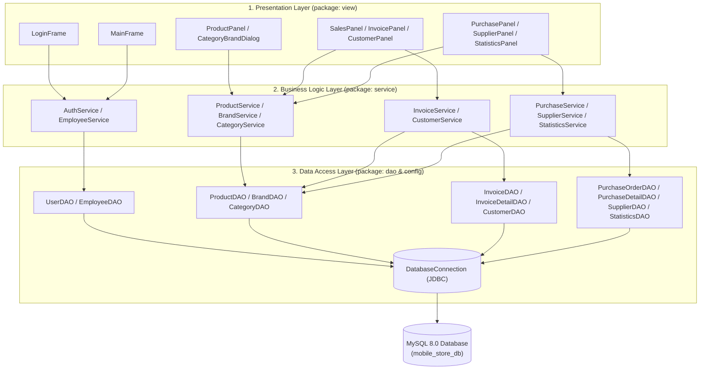
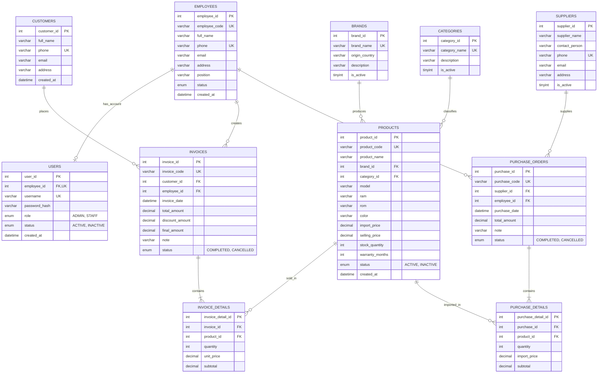
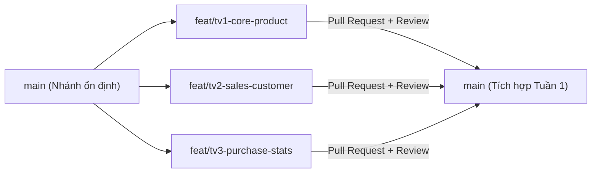

# KẾ HOẠCH TRIỂN KHAI & PHÂN CHIA CÔNG VIỆC DỰ ÁN
## PHẦN MỀM QUẢN LÝ CỬA HÀNG ĐIỆN THOẠI DI ĐỘNG (MOBILE PHONE STORE MANAGEMENT SYSTEM)

> **Tài liệu Quản lý Dự án & Kiến trúc Kỹ thuật Chính thức**
> - **Học phần:** Lập trình Java (OOP & Desktop Application)
> - **Quy mô nhóm:** 3 Thành viên
> - **Thời gian thực hiện:** 21 Ngày (3 Tuần)
> - **Kiến trúc:** 3-Layer Architecture (GUI - BLL/Service - DAL/DAO)
> - **Công nghệ cốt lõi:** Java 17 (LTS), Java Swing, JDBC, MySQL 8.0, Maven, Git/GitHub

---

# PHẦN 1 — TỔNG QUAN DỰ ÁN

## 1.1. Tên dự án
- **Tên tiếng Việt:** Phần mềm Quản lý Cửa hàng Điện thoại Di động
- **Tên tiếng Anh:** Mobile Phone Store Management System (`PhoneStoreApp`)

## 1.2. Mục tiêu dự án
1. **Mục tiêu học thuật (Academic Goals):**
   - Áp dụng triệt để 4 tính chất Lập trình Hướng đối tượng (Đóng gói - Encapsulation, Kế thừa - Inheritance, Đa hình - Polymorphism, Trừu tượng - Abstraction) vào bài toán thực tế.
   - Tổ chức code theo mô hình kiến trúc **3 lớp (3-Layer Architecture)** rõ ràng, tách biệt hoàn toàn giao diện (`view`), xử lý nghiệp vụ (`service`) và truy xuất dữ liệu (`dao`).
   - Làm chủ kỹ thuật lập trình cơ sở dữ liệu với **JDBC** (`PreparedStatement`, quản lý `Connection`, và đặc biệt là **Database Transaction** `commit`/`rollback`).
   - Thiết kế giao diện Desktop bằng **Java Swing** trực quan, đồng nhất, bắt sự kiện mượt mà và kiểm soát lỗi nhập liệu chặt chẽ.
2. **Mục tiêu nghiệp vụ (Business Goals):**
   - Tin học hóa quy trình vận hành cốt lõi của một cửa hàng bán lẻ điện thoại: Quản lý danh mục/thương hiệu/sản phẩm, quản lý tồn kho theo số lượng, nhập hàng từ nhà cung cấp, bán hàng lập hóa đơn và thống kê doanh thu.
   - Đảm bảo tính chính xác tuyệt đối của số lượng tồn kho và doanh thu sau mỗi giao dịch mua/bán.

## 1.3. Đánh giá tính khả thi & Điều chỉnh phạm vi (Scope Management)
Với quỹ thời gian **21 ngày** cho **3 sinh viên**, để đảm bảo dự án **hoàn thành 100%, chạy ổn định, không phát sinh lỗi lúc bảo vệ**, phạm vi dự án được chuẩn hóa như sau:

| Hạng mục | Quyết định phạm vi trong 3 tuần | Lý do kỹ thuật & Quản lý dự án |
| :--- | :--- | :--- |
| **Quản lý tồn kho** | Quản lý theo **Số lượng (`stock_quantity`)** trên từng mẫu máy (Model + RAM + ROM + Màu). **Không** quản lý từng mã IMEI/Serial riêng lẻ. | Quản lý IMEI đòi hỏi bảng phụ `product_imeis` và quét từng IMEI khi nhập/xuất, làm tăng gấp đôi độ phức tạp GUI & DAO của TV2, TV3. |
| **Quản lý tài khoản & Nhân viên** | Gộp bảng `users` và `employees` thành quan hệ 1-1 rõ ràng (hoặc tích hợp thông tin đăng nhập trực tiếp/liên kết chặt) và giao cho **Thành viên 1** làm trong module Quản lý Nhân viên & Tài khoản. | Cân bằng khối lượng công việc, giúp TV1 kiểm soát toàn bộ luồng Phân quyền (`ADMIN` vs `STAFF`) ngay từ đầu. |
| **Quy trình Nhập hàng** | Nhập hàng **1 bước (Tạo phiếu & Hoàn tất ngay)**, tự động cộng tồn kho và cập nhật giá nhập mới nhất. Không làm trạng thái "Chờ duyệt / Đang giao / Hủy phiếu". | Tránh rắc rối về state-machine không cần thiết, tập trung vào JDBC Transaction. |
| **Giảm giá (Discount)** | Hỗ trợ giảm giá trực tiếp bằng số tiền (VNĐ) hoặc % đơn giản trên tổng hóa đơn. Không làm hệ thống Voucher/Coupon phức tạp. | Đủ điểm nhấn nghiệp vụ nhưng không tốn thời gian làm CRUD khuyến mãi. |
| **In hóa đơn / Xuất file** | Hiển thị Dialog **Xem trước Hóa đơn (Invoice Preview)** định dạng đẹp + Xuất file `.txt`/`.html` hoặc `.csv` (Excel) bằng thư viện chuẩn của Java (`java.io`). Xuất PDF (`iText`/`OpenPDF`) là **Tùy chọn (Bonus)** ở Tuần 3. | Tránh lỗi thiếu font tiếng Việt của thư viện PDF bên thứ 3 nếu nhóm chưa quen cấu hình Maven. |
| **Biểu đồ thống kê** | Sử dụng các **Summary Cards (Thẻ chỉ số)** kết hợp **JTable** tổng hợp doanh thu và thanh tiến trình trực quan (`JProgressBar`) hoặc vẽ biểu đồ cột đơn giản bằng `Graphics2D`. | Không phụ thuộc thư viện nặng (`JFreeChart`), code thuần Swing dễ giải thích khi vấn đáp. |

## 1.4. Công nghệ sử dụng (Tech Stack)
- **Ngôn ngữ & JDK:** Java 17 LTS (tương thích hoàn toàn từ Java 11 đến Java 21).
- **Build Tool:** Apache Maven (`pom.xml` quản lý thư viện `mysql-connector-j` và `flatlaf` làm đẹp giao diện Swing).
- **IDE khuyến nghị:** IntelliJ IDEA (Community/Ultimate) hoặc Apache NetBeans.
- **Giao diện (GUI):** Java Swing + thư viện giao diện hiện đại **FlatLaf** (chỉ cần 1 dòng cấu hình giúp Swing phẳng, đẹp như ứng dụng hiện đại).
- **Cơ sở dữ liệu:** MySQL 8.0+ (hoặc MariaDB 10.4+ qua XAMPP/MySQL Community Server).
- **Kết nối CSDL:** JDBC (`mysql-connector-j` phiên bản `8.3.0`).
- **Quản lý mã nguồn:** Git & GitHub.

---

# PHẦN 2 — PHÂN TÍCH CHỨC NĂNG CHI TIẾT

Dự án được chia thành **8 Module chức năng** với mức độ ưu tiên theo chuẩn **MoSCoW** (`P1 - Bắt buộc (Must Have)`, `P2 - Quan trọng (Should Have)`, `P3 - Nên có/Tùy chọn (Could Have)`):

## 2.1. Danh sách Module & Phân tích Input / Output / Luồng nghiệp vụ

### Module 1: Đăng nhập, Phân quyền & Quản lý Nhân viên (`Auth & Employee`)
- **Mức độ ưu tiên:** `P1 - Bắt buộc`
- **Phụ trách:** Thành viên 1
- **Mô tả chức năng:**
  - Xác thực người dùng qua `username` và `password`.
  - Lưu phiên đăng nhập hiện tại vào lớp `SessionManager` (`currentUser`, `currentEmployee`).
  - Phân quyền giao diện trên `MainFrame`:
    - `ADMIN`: Toàn quyền truy cập tất cả các tab chức năng.
    - `STAFF` (Nhân viên bán hàng/kho): Chỉ truy cập Bán hàng, Hóa đơn, Khách hàng, Sản phẩm (chế độ xem/tra cứu), Nhập hàng; **ẩn/khóa** tab Quản lý Nhân viên & Thống kê doanh thu nhạy cảm.
  - Đổi mật khẩu cá nhân.
  - CRUD Nhân viên & cấp tài khoản đăng nhập, khóa/mở khóa tài khoản (`status`).
- **Input:** `username`, `password`, thông tin nhân viên (`code`, `fullName`, `phone`, `email`, `role`, `status`).
- **Output:** Đối tượng `User` + `Employee` trong phiên làm việc, thông báo trạng thái đăng nhập, danh sách nhân viên trên `JTable`.
- **Luồng nghiệp vụ chính (Đăng nhập):**
  1. Người dùng nhập `username`, `password` tại `LoginFrame`.
  2. `AuthService` kiểm tra rỗng $\rightarrow$ gọi `UserDAO.findByUsername(username)`.
  3. Kiểm tra tài khoản tồn tại, `status == ACTIVE` và khớp mật khẩu.
  4. Lưu vào `SessionManager.setCurrentUser(user)` $\rightarrow$ Mở `MainFrame` và ẩn các menu không thuộc quyền.

### Module 2: Quản lý Danh mục & Thương hiệu (`Category & Brand`)
- **Mức độ ưu tiên:** `P1 - Bắt buộc`
- **Phụ trách:** Thành viên 1
- **Mô tả chức năng:**
  - Thêm, sửa, xóa mềm/kiểm tra ràng buộc, tìm kiếm **Thương hiệu** (Apple, Samsung, Xiaomi, OPPO...) và **Danh mục** (Flagship, Tầm trung, Giá rẻ, Gaming Phone...).
- **Input:** Tên thương hiệu, xuất xứ, mô tả; Tên danh mục, mô tả.
- **Output:** Danh sách `Brand` và `Category` hiển thị trên `JTable` và nạp vào `JComboBox` ở màn hình Sản phẩm.
- **Luồng nghiệp vụ xóa an toàn:** Khi xóa 1 Thương hiệu/Danh mục, `BrandService` kiểm tra xem đã có sản phẩm nào thuộc thương hiệu đó chưa (`ProductDAO.countByBrandId()`). Nếu $> 0$, từ chối xóa và báo lỗi để bảo toàn dữ liệu.

### Module 3: Quản lý Điện thoại (`Product Management`)
- **Mức độ ưu tiên:** `P1 - Bắt buộc`
- **Phụ trách:** Thành viên 1
- **Mô tả chức năng:**
  - Thêm mới, cập nhật, ngừng kinh doanh (xóa mềm), xem danh sách điện thoại.
  - Tìm kiếm đa điều kiện: Theo từ khóa (Mã SP, Tên SP, Model) kết hợp lọc theo `JComboBox` Thương hiệu, Danh mục và trạng thái tồn kho.
  - Quản lý cấu hình chi tiết: Mã SP (`product_code`), Tên máy, Thương hiệu, Danh mục, RAM, ROM (Bộ nhớ trong), Màu sắc, Giá nhập (`import_price`), Giá bán (`selling_price`), Số lượng tồn (`stock_quantity`), Thời gian bảo hành (tháng).
- **Input:** Thông tin thuộc tính `Product`, bộ lọc tìm kiếm.
- **Output:** Danh sách `Product` hiển thị trên `JTable`, cảnh báo nếu giá bán $<$ giá nhập.

### Module 4: Quản lý Khách hàng (`Customer Management`)
- **Mức độ ưu tiên:** `P1 - Bắt buộc`
- **Phụ trách:** Thành viên 2
- **Mô tả chức năng:**
  - Thêm, sửa, xóa khách hàng (chỉ xóa được khách hàng chưa từng mua hàng), tìm kiếm nhanh theo **Số điện thoại** hoặc **Họ tên**.
  - Cho phép thêm nhanh khách hàng ngay trong lúc lập hóa đơn bán hàng (Dialog tạo nhanh).
  - Xem lịch sử các hóa đơn mà khách hàng đó đã mua.
- **Input:** Họ tên, Số điện thoại (duy nhất, 10 chữ số), Địa chỉ, Email.
- **Output:** Đối tượng `Customer`, danh sách khách hàng và lịch sử giao dịch.

### Module 5: Quản lý Bán hàng & Lập Hóa đơn (`POS / Sales & Invoice`)
- **Mức độ ưu tiên:** `P1 - Bắt buộc (Nghiệp vụ cốt lõi quan trọng nhất)`
- **Phụ trách:** Thành viên 2
- **Mô tả chức năng:**
  - **Màn hình Bán hàng (POS):**
    - Tìm và chọn sản phẩm từ bảng danh sách sản phẩm còn hàng (`stock_quantity > 0`).
    - Thêm một hoặc nhiều điện thoại vào **Giỏ hàng tạm (Cart Table)** trên giao diện.
    - Điều chỉnh số lượng mua, xóa mặt hàng khỏi giỏ.
    - Chọn khách hàng (tìm theo SĐT hoặc chọn "Khách vãng lai" / tạo mới khách hàng).
    - Tự động tính: `Thành tiền từng dòng = Số lượng * Đơn giá bán`, `Tổng tiền hàng`, trừ `Giảm giá (Discount)` $\rightarrow$ `Tổng thanh toán cuối cùng`.
    - Kiểm tra tồn kho tức thì (Realtime check) và kiểm tra lại trong DB trước khi lưu.
    - Thực hiện **Transaction** lưu hóa đơn (`invoices`), lưu các dòng chi tiết (`invoice_details`) và trừ số lượng tồn kho (`products.stock_quantity`).
  - **Màn hình Quản lý Lịch sử Hóa đơn:**
    - Xem danh sách hóa đơn đã lập, lọc theo khoảng ngày (`Từ ngày - Đến ngày`), tìm theo mã hóa đơn hoặc tên/SĐT khách hàng.
    - Click chọn hóa đơn để xem bảng Chi tiết các mặt hàng đã mua trong hóa đơn đó.
    - Xem bản in hóa đơn (Dialog/Xuất file).
- **Input:** `Customer`, `Employee` (từ Session), `List<InvoiceDetail>`, `discountAmount`, `note`.
- **Output:** Mã hóa đơn tự sinh (VD: `HD20261104-001`), cập nhật tồn kho giảm tương ứng, thông báo thanh toán thành công.

### Module 6: Quản lý Nhà cung cấp (`Supplier Management`)
- **Mức độ ưu tiên:** `P2 - Quan trọng`
- **Phụ trách:** Thành viên 3
- **Mô tả chức năng:**
  - Thêm, sửa, xóa (nếu chưa có phiếu nhập), tìm kiếm Nhà cung cấp/Nhà phân phối điện thoại.
- **Input:** Tên nhà cung cấp, người liên hệ, số điện thoại, email, địa chỉ.
- **Output:** Danh sách `Supplier` trên `JTable` và `JComboBox` tại màn hình Nhập hàng.

### Module 7: Quản lý Nhập hàng & Phiếu nhập (`Purchasing & Inventory Inbound`)
- **Mức độ ưu tiên:** `P1 - Bắt buộc`
- **Phụ trách:** Thành viên 3
- **Mô tả chức năng:**
  - **Tạo Phiếu nhập kho:**
    - Chọn Nhà cung cấp từ `JComboBox`.
    - Chọn điện thoại cần nhập từ danh sách sản phẩm, nhập **Số lượng nhập** ($>0$) và **Đơn giá nhập** ($>0$).
    - Thêm nhiều mặt hàng vào danh sách chờ nhập.
    - Tự động tính thành tiền từng dòng và **Tổng tiền phiếu nhập**.
    - Xác nhận hoàn tất phiếu nhập: Sử dụng **JDBC Transaction** để lưu `purchase_orders`, `purchase_details`, đồng thời **cộng thêm tồn kho** (`stock_quantity = stock_quantity + quantity`) và cập nhật `import_price` mới nhất cho sản phẩm.
  - **Lịch sử Phiếu nhập:**
    - Tra cứu phiếu nhập theo mã phiếu, nhà cung cấp hoặc khoảng thời gian.
    - Xem chi tiết các mặt hàng trong từng phiếu nhập.
- **Input:** `Supplier`, `Employee` (từ Session), `List<PurchaseDetail>`, `note`.
- **Output:** Mã phiếu nhập (VD: `PN20261104-001`), tồn kho sản phẩm tăng chính xác.

### Module 8: Thống kê & Báo cáo (`Dashboard & Statistics`)
- **Mức độ ưu tiên:** `P2 - Quan trọng`
- **Phụ trách:** Thành viên 3
- **Mô tả chức năng:**
  - **4 Thẻ tổng quan (Summary Cards):** Tổng số mẫu điện thoại đang kinh doanh, Tổng số khách hàng, Tổng số hóa đơn bán ra, Tổng doanh thu tháng hiện tại.
  - **Thống kê Doanh thu & Lợi nhuận ước tính:**
    - Theo Ngày (trong khoảng `Từ ngày - Đến ngày`).
    - Theo Tháng (12 tháng trong năm được chọn).
  - **Thống kê Sản phẩm bán chạy (Top Selling Products):** Top 5 / Top 10 điện thoại có số lượng bán cao nhất và doanh thu mang lại.
  - **Cảnh báo Tồn kho thấp (Low Stock Alert):** Danh sách các sản phẩm có `stock_quantity <= 5` để cửa hàng kịp thời nhập thêm hàng.

---

# PHẦN 3 — THIẾT KẾ HỆ THỐNG

## 3.1. Kiến trúc 3 lớp (3-Layer Architecture)

Hệ thống tuân thủ nghiêm ngặt nguyên tắc luồng gọi một chiều: **`View (GUI)` $\rightarrow$ `Service (BLL)` $\rightarrow$ `DAO (DAL)` $\rightarrow$ `MySQL Database`**. Tuyệt đối **không** viết câu lệnh SQL (`ResultSet`, `Connection`) trực tiếp bên trong các lớp giao diện `JFrame`/`JPanel`.



## 3.2. Cấu trúc Package và Thư mục Dự án (Maven Standard Layout)

```text
PhoneStoreManagement/
├── pom.xml                                  # Cấu hình Maven (MySQL Connector, FlatLaf)
├── README.md                                # Hướng dẫn cài đặt và chạy dự án
├── PROJECT_PLAN.md                          # Tài liệu kế hoạch & thiết kế dự án
├── database/
│   ├── schema.sql                           # Script tạo bảng, khóa chính, khóa ngoại
│   └── sample_data.sql                      # Script dữ liệu mẫu để demo và kiểm thử
└── src/
    └── main/
        ├── java/
        │   └── com/phonestore/
        │       ├── Main.java                # Điểm khởi chạy ứng dụng (Entry point)
        │       ├── config/
        │       │   └── DatabaseConnection.java  # Quản lý kết nối JDBC tới MySQL
        │       ├── model/                   # Các lớp thực thể (POJO / Entity)
        │       │   ├── User.java
        │       │   ├── Employee.java
        │       │   ├── Brand.java
        │       │   ├── Category.java
        │       │   ├── Product.java
        │       │   ├── Customer.java
        │       │   ├── Supplier.java
        │       │   ├── Invoice.java
        │       │   ├── InvoiceDetail.java
        │       │   ├── PurchaseOrder.java
        │       │   ├── PurchaseDetail.java
        │       │   └── dto/                 # Các lớp chứa dữ liệu thống kê tổng hợp
        │       │       ├── RevenueStatDTO.java
        │       │       ├── TopProductDTO.java
        │       │       └── DashboardSummaryDTO.java
        │       ├── dao/                     # Lớp truy xuất CSDL (SQL Queries & Transactions)
        │       │   ├── UserDAO.java
        │       │   ├── EmployeeDAO.java
        │       │   ├── BrandDAO.java
        │       │   ├── CategoryDAO.java
        │       │   ├── ProductDAO.java
        │       │   ├── CustomerDAO.java
        │       │   ├── InvoiceDAO.java
        │       │   ├── InvoiceDetailDAO.java
        │       │   ├── SupplierDAO.java
        │       │   ├── PurchaseOrderDAO.java
        │       │   ├── PurchaseDetailDAO.java
        │       │   └── StatisticsDAO.java
        │       ├── service/                 # Lớp xử lý nghiệp vụ & Validate dữ liệu
        │       │   ├── AuthService.java
        │       │   ├── EmployeeService.java
        │       │   ├── BrandService.java
        │       │   ├── CategoryService.java
        │       │   ├── ProductService.java
        │       │   ├── CustomerService.java
        │       │   ├── InvoiceService.java
        │       │   ├── SupplierService.java
        │       │   ├── PurchaseService.java
        │       │   └── StatisticsService.java
        │       ├── view/                    # Giao diện người dùng Java Swing
        │       │   ├── LoginFrame.java
        │       │   ├── MainFrame.java
        │       │   ├── ChangePasswordDialog.java
        │       │   ├── ProductPanel.java
        │       │   ├── CategoryBrandDialog.java
        │       │   ├── EmployeePanel.java
        │       │   ├── CustomerPanel.java
        │       │   ├── SalesPanel.java
        │       │   ├── InvoicePanel.java
        │       │   ├── InvoiceDetailDialog.java
        │       │   ├── SupplierPanel.java
        │       │   ├── PurchasePanel.java
        │       │   ├── PurchaseHistoryPanel.java
        │       │   └── StatisticsPanel.java
        │       └── utils/                   # Tiện ích dùng chung toàn hệ thống
        │           ├── SessionManager.java  # Lưu thông tin User/Employee đang đăng nhập
        │           ├── CurrencyUtils.java   # Định dạng tiền tệ VNĐ (15.990.000 đ)
        │           ├── DateUtils.java       # Định dạng ngày giờ (dd/MM/yyyy HH:mm)
        │           ├── ValidationUtils.java # Kiểm tra SĐT, Email, số dương, chuỗi rỗng
        │           └── MessageUtils.java    # Hộp thoại JOptionPane chuẩn hóa
        └── resources/
            └── icons/                       # Icon PNG 16x16, 24x24 cho nút bấm & menu
```

## 3.3. Đặc tả API Nội bộ Dùng Chung (Internal API Contract)

> [!IMPORTANT]
> **Nguyên tắc sống còn để 3 thành viên code song song từ Ngày 2:**
> Thành viên 2 (Bán hàng) và Thành viên 3 (Nhập hàng & Thống kê) đều cần thông tin `Product` và `Employee` của Thành viên 1. Do đó, ngay trong **Ngày 2**, Thành viên 1 phải commit các class trong `config`, `utils`, `model` và các chữ ký hàm (method signatures) dưới đây lên nhánh `main`.

### 1. `DatabaseConnection` (`com.phonestore.config`)
```java
package com.phonestore.config;

import java.sql.Connection;
import java.sql.DriverManager;
import java.sql.SQLException;

public class DatabaseConnection {
    private static final String URL = "jdbc:mysql://localhost:3306/mobile_store_db?useSSL=false&serverTimezone=Asia/Ho_Chi_Minh&allowPublicKeyRetrieval=true&characterEncoding=UTF-8";
    private static final String USER = "root";
    private static final String PASSWORD = ""; // Cập nhật theo cấu hình máy local

    public static Connection getConnection() throws SQLException {
        return DriverManager.getConnection(URL, USER, PASSWORD);
    }
}
```

### 2. `SessionManager` (`com.phonestore.utils`)
```java
public class SessionManager {
    private static User currentUser;
    private static Employee currentEmployee;

    public static void login(User user, Employee employee) { ... }
    public static void logout() { ... }
    public static User getCurrentUser() { ... }
    public static Employee getCurrentEmployee() { ... }
    public static boolean isAdmin() {
        return currentUser != null && "ADMIN".equalsIgnoreCase(currentUser.getRole());
    }
}
```

### 3. Hợp đồng phương thức của `ProductDAO` (Thành viên 1 cung cấp cho TV2 & TV3)
```java
public class ProductDAO {
    // TV1, TV2, TV3 dùng để hiển thị danh sách sản phẩm
    public List<Product> findAllActive();
    public Product findById(int productId);
    public Product findByCode(String productCode);
    public List<Product> searchProducts(String keyword, Integer brandId, Integer categoryId, boolean onlyInStock);

    // QUAN TRỌNG: Dùng trong Transaction của TV2 (Bán hàng) và TV3 (Nhập hàng)
    // Nhận vào đối tượng Connection đang mở Transaction (autoCommit = false)
    public boolean updateStockInTransaction(Connection conn, int productId, int quantityDelta) throws SQLException;
    public boolean updateStockAndImportPriceInTransaction(Connection conn, int productId, int quantityAdded, BigDecimal newImportPrice) throws SQLException;
}
```
*Giải thích câu SQL an toàn chống âm kho trong `updateStockInTransaction` khi bán hàng (`quantityDelta < 0`):*
```sql
UPDATE products
SET stock_quantity = stock_quantity + ?
WHERE product_id = ? AND (stock_quantity + ?) >= 0;
```
Nếu `executeUpdate()` trả về `0` dòng $\rightarrow$ Tồn kho không đủ $\rightarrow$ `InvoiceService` lập tức `conn.rollback()` và báo lỗi!

---

# PHẦN 4 — THIẾT KẾ DATABASE (MySQL)

## 4.1. Sơ đồ Thực thể Liên kết (ERD)



## 4.2. Quy tắc Toàn vẹn Dữ liệu (Data Integrity Rules)
1. **Ràng buộc Duy nhất (`UNIQUE`):**
   - `employees.employee_code`, `employees.phone`
   - `users.username`, `users.employee_id` (Mỗi nhân viên chỉ có tối đa 1 tài khoản đăng nhập)
   - `products.product_code` (Mã SP duy nhất, ví dụ `SP001`)
   - `customers.phone` (Tra cứu khách hàng chính xác qua SĐT)
   - `invoices.invoice_code` (Mã hóa đơn duy nhất, ví dụ `HD20261101-001`)
   - `purchase_orders.purchase_code` (Mã phiếu nhập duy nhất, ví dụ `PN20261101-001`)
2. **Ràng buộc Miền giá trị (`CHECK` Constraints & Validation tại BLL):**
   - `products.stock_quantity >= 0` (Không bao giờ cho phép tồn kho âm).
   - `products.import_price >= 0` và `products.selling_price >= import_price`.
   - `invoice_details.quantity > 0` và `purchase_details.quantity > 0`.
   - `invoices.final_amount = invoices.total_amount - invoices.discount_amount >= 0`.
3. **Chính sách Xóa dữ liệu (`ON DELETE RESTRICT` & Soft Delete):**
   - Tất cả khóa ngoại trên bảng giao dịch (`invoices`, `invoice_details`, `purchase_orders`, `purchase_details`) đều đặt `ON DELETE RESTRICT`.
   - Khi sản phẩm đã phát sinh hóa đơn hoặc phiếu nhập, hệ thống chuyển `products.status = 'INACTIVE'` (Ngừng kinh doanh) thay vì `DELETE` vật lý để giữ nguyên lịch sử báo cáo doanh thu.

## 4.3. Script Khởi tạo Database & Dữ liệu Mẫu Hoàn chỉnh (`database/init_db.sql`)

Các thành viên có thể copy toàn bộ khối SQL dưới đây chạy trực tiếp trong **MySQL Workbench** để khởi tạo đầy đủ 11 bảng và dữ liệu mẫu phục vụ phát triển & demo:

```sql
-- ============================================================================
-- SCRIPT KHỞI TẠO CƠ SỞ DỮ LIỆU & DỮ LIỆU MẪU
-- DỰ ÁN: PHẦN MỀM QUẢN LÝ CỬA HÀNG ĐIỆN THOẠI DI ĐỘNG
-- ============================================================================

DROP DATABASE IF EXISTS mobile_store_db;
CREATE DATABASE mobile_store_db CHARACTER SET utf8mb4 COLLATE utf8mb4_unicode_ci;
USE mobile_store_db;

-- 1. Bảng employees (Nhân viên)
CREATE TABLE employees (
    employee_id INT AUTO_INCREMENT PRIMARY KEY,
    employee_code VARCHAR(20) NOT NULL UNIQUE,
    full_name VARCHAR(100) NOT NULL,
    phone VARCHAR(15) NOT NULL UNIQUE,
    email VARCHAR(100),
    address VARCHAR(255),
    position VARCHAR(50) NOT NULL DEFAULT 'Nhân viên bán hàng',
    status ENUM('ACTIVE', 'INACTIVE') NOT NULL DEFAULT 'ACTIVE',
    created_at DATETIME NOT NULL DEFAULT CURRENT_TIMESTAMP
) ENGINE=InnoDB;

-- 2. Bảng users (Tài khoản đăng nhập - Quan hệ 1-1 với employees)
CREATE TABLE users (
    user_id INT AUTO_INCREMENT PRIMARY KEY,
    employee_id INT NOT NULL UNIQUE,
    username VARCHAR(50) NOT NULL UNIQUE,
    password_hash VARCHAR(255) NOT NULL,
    role ENUM('ADMIN', 'STAFF') NOT NULL DEFAULT 'STAFF',
    status ENUM('ACTIVE', 'INACTIVE') NOT NULL DEFAULT 'ACTIVE',
    created_at DATETIME NOT NULL DEFAULT CURRENT_TIMESTAMP,
    CONSTRAINT fk_users_employee FOREIGN KEY (employee_id) REFERENCES employees(employee_id) ON DELETE RESTRICT
) ENGINE=InnoDB;

-- 3. Bảng brands (Thương hiệu)
CREATE TABLE brands (
    brand_id INT AUTO_INCREMENT PRIMARY KEY,
    brand_name VARCHAR(100) NOT NULL UNIQUE,
    origin_country VARCHAR(100),
    description VARCHAR(255),
    is_active TINYINT(1) NOT NULL DEFAULT 1
) ENGINE=InnoDB;

-- 4. Bảng categories (Danh mục điện thoại)
CREATE TABLE categories (
    category_id INT AUTO_INCREMENT PRIMARY KEY,
    category_name VARCHAR(100) NOT NULL UNIQUE,
    description VARCHAR(255),
    is_active TINYINT(1) NOT NULL DEFAULT 1
) ENGINE=InnoDB;

-- 5. Bảng products (Điện thoại)
CREATE TABLE products (
    product_id INT AUTO_INCREMENT PRIMARY KEY,
    product_code VARCHAR(30) NOT NULL UNIQUE,
    product_name VARCHAR(150) NOT NULL,
    brand_id INT NOT NULL,
    category_id INT NOT NULL,
    model VARCHAR(100),
    ram VARCHAR(20) NOT NULL,
    rom VARCHAR(20) NOT NULL,
    color VARCHAR(50) NOT NULL,
    import_price DECIMAL(15, 2) NOT NULL DEFAULT 0 CHECK (import_price >= 0),
    selling_price DECIMAL(15, 2) NOT NULL DEFAULT 0 CHECK (selling_price >= 0),
    stock_quantity INT NOT NULL DEFAULT 0 CHECK (stock_quantity >= 0),
    warranty_months INT NOT NULL DEFAULT 12 CHECK (warranty_months >= 0),
    status ENUM('ACTIVE', 'INACTIVE') NOT NULL DEFAULT 'ACTIVE',
    created_at DATETIME NOT NULL DEFAULT CURRENT_TIMESTAMP,
    CONSTRAINT fk_products_brand FOREIGN KEY (brand_id) REFERENCES brands(brand_id) ON DELETE RESTRICT,
    CONSTRAINT fk_products_category FOREIGN KEY (category_id) REFERENCES categories(category_id) ON DELETE RESTRICT
) ENGINE=InnoDB;

-- 6. Bảng customers (Khách hàng)
CREATE TABLE customers (
    customer_id INT AUTO_INCREMENT PRIMARY KEY,
    full_name VARCHAR(100) NOT NULL,
    phone VARCHAR(15) NOT NULL UNIQUE,
    email VARCHAR(100),
    address VARCHAR(255),
    created_at DATETIME NOT NULL DEFAULT CURRENT_TIMESTAMP
) ENGINE=InnoDB;

-- 7. Bảng suppliers (Nhà cung cấp)
CREATE TABLE suppliers (
    supplier_id INT AUTO_INCREMENT PRIMARY KEY,
    supplier_name VARCHAR(150) NOT NULL,
    contact_person VARCHAR(100),
    phone VARCHAR(15) NOT NULL UNIQUE,
    email VARCHAR(100),
    address VARCHAR(255),
    is_active TINYINT(1) NOT NULL DEFAULT 1
) ENGINE=InnoDB;

-- 8. Bảng purchase_orders (Phiếu nhập hàng)
CREATE TABLE purchase_orders (
    purchase_id INT AUTO_INCREMENT PRIMARY KEY,
    purchase_code VARCHAR(30) NOT NULL UNIQUE,
    supplier_id INT NOT NULL,
    employee_id INT NOT NULL,
    purchase_date DATETIME NOT NULL DEFAULT CURRENT_TIMESTAMP,
    total_amount DECIMAL(15, 2) NOT NULL DEFAULT 0 CHECK (total_amount >= 0),
    note VARCHAR(255),
    status ENUM('COMPLETED', 'CANCELLED') NOT NULL DEFAULT 'COMPLETED',
    CONSTRAINT fk_po_supplier FOREIGN KEY (supplier_id) REFERENCES suppliers(supplier_id) ON DELETE RESTRICT,
    CONSTRAINT fk_po_employee FOREIGN KEY (employee_id) REFERENCES employees(employee_id) ON DELETE RESTRICT
) ENGINE=InnoDB;

-- 9. Bảng purchase_details (Chi tiết phiếu nhập)
CREATE TABLE purchase_details (
    purchase_detail_id INT AUTO_INCREMENT PRIMARY KEY,
    purchase_id INT NOT NULL,
    product_id INT NOT NULL,
    quantity INT NOT NULL CHECK (quantity > 0),
    import_price DECIMAL(15, 2) NOT NULL CHECK (import_price >= 0),
    subtotal DECIMAL(15, 2) NOT NULL CHECK (subtotal >= 0),
    CONSTRAINT fk_pd_purchase FOREIGN KEY (purchase_id) REFERENCES purchase_orders(purchase_id) ON DELETE CASCADE,
    CONSTRAINT fk_pd_product FOREIGN KEY (product_id) REFERENCES products(product_id) ON DELETE RESTRICT
) ENGINE=InnoDB;

-- 10. Bảng invoices (Hóa đơn bán hàng)
CREATE TABLE invoices (
    invoice_id INT AUTO_INCREMENT PRIMARY KEY,
    invoice_code VARCHAR(30) NOT NULL UNIQUE,
    customer_id INT NOT NULL,
    employee_id INT NOT NULL,
    invoice_date DATETIME NOT NULL DEFAULT CURRENT_TIMESTAMP,
    total_amount DECIMAL(15, 2) NOT NULL DEFAULT 0 CHECK (total_amount >= 0),
    discount_amount DECIMAL(15, 2) NOT NULL DEFAULT 0 CHECK (discount_amount >= 0),
    final_amount DECIMAL(15, 2) NOT NULL DEFAULT 0 CHECK (final_amount >= 0),
    note VARCHAR(255),
    status ENUM('COMPLETED', 'CANCELLED') NOT NULL DEFAULT 'COMPLETED',
    CONSTRAINT fk_inv_customer FOREIGN KEY (customer_id) REFERENCES customers(customer_id) ON DELETE RESTRICT,
    CONSTRAINT fk_inv_employee FOREIGN KEY (employee_id) REFERENCES employees(employee_id) ON DELETE RESTRICT
) ENGINE=InnoDB;

-- 11. Bảng invoice_details (Chi tiết hóa đơn bán hàng)
CREATE TABLE invoice_details (
    invoice_detail_id INT AUTO_INCREMENT PRIMARY KEY,
    invoice_id INT NOT NULL,
    product_id INT NOT NULL,
    quantity INT NOT NULL CHECK (quantity > 0),
    unit_price DECIMAL(15, 2) NOT NULL CHECK (unit_price >= 0),
    subtotal DECIMAL(15, 2) NOT NULL CHECK (subtotal >= 0),
    CONSTRAINT fk_id_invoice FOREIGN KEY (invoice_id) REFERENCES invoices(invoice_id) ON DELETE CASCADE,
    CONSTRAINT fk_id_product FOREIGN KEY (product_id) REFERENCES products(product_id) ON DELETE RESTRICT
) ENGINE=InnoDB;

-- ============================================================================
-- DỮ LIỆU MẪU (SAMPLE DATA) PHỤC VỤ CHẠY THỬ VÀ DEMO BẢO VỆ
-- ============================================================================

INSERT INTO employees (employee_code, full_name, phone, email, address, position, status) VALUES
('NV001', 'Nguyễn Quản Trị', '0901000001', 'admin@phonestore.vn', 'Quận 1, TP.HCM', 'Cửa hàng trưởng', 'ACTIVE'),
('NV002', 'Trần Thị Bán Hàng', '0901000002', 'staff1@phonestore.vn', 'Quận 3, TP.HCM', 'Nhân viên bán hàng', 'ACTIVE'),
('NV003', 'Lê Văn Thủ Kho', '0901000003', 'staff2@phonestore.vn', 'Quận Bình Thạnh, TP.HCM', 'Nhân viên kho', 'ACTIVE');

-- Mật khẩu mặc định để dễ test: '123456' (hoặc SHA-256 tùy quy ước nhóm trong AuthService)
INSERT INTO users (employee_id, username, password_hash, role, status) VALUES
(1, 'admin', '123456', 'ADMIN', 'ACTIVE'),
(2, 'nhanvien1', '123456', 'STAFF', 'ACTIVE'),
(3, 'nhanvien2', '123456', 'STAFF', 'ACTIVE');

INSERT INTO brands (brand_name, origin_country, description) VALUES
('Apple', 'Mỹ', 'Dòng điện thoại iPhone chính hãng VN/A'),
('Samsung', 'Hàn Quốc', 'Điện thoại Samsung Galaxy S, Z, A series'),
('Xiaomi', 'Trung Quốc', 'Điện thoại Xiaomi & Redmi cấu hình cao'),
('OPPO', 'Trung Quốc', 'Điện thoại OPPO Reno & Find series');

INSERT INTO categories (category_name, description) VALUES
('Flagship Cao Cấp', 'Dòng máy đầu bảng hiệu năng và camera cao nhất'),
('Cận Cao Cấp & Tầm Trung', 'Dòng máy cân bằng hiệu năng và chi phí'),
('Điện Thoại Phổ Thông Giá Rẻ', 'Dòng máy nhu cầu cơ bản, pin lớn'),
('Điện Thoại Gập (Foldable)', 'Dòng smartphone màn hình gập công nghệ mới');

INSERT INTO products (product_code, product_name, brand_id, category_id, model, ram, rom, color, import_price, selling_price, stock_quantity, warranty_months) VALUES
('SP001', 'iPhone 16 Pro Max 256GB VN/A', 1, 1, 'A3296', '8GB', '256GB', 'Titan Tự Nhiên', 29500000, 33990000, 15, 12),
('SP002', 'iPhone 16 128GB VN/A', 1, 1, 'A3287', '8GB', '128GB', 'Xanh Lưu Ly', 19200000, 22490000, 20, 12),
('SP003', 'Samsung Galaxy S24 Ultra 5G', 2, 1, 'SM-S928B', '12GB', '256GB', 'Xám Titan', 24000000, 27990000, 10, 12),
('SP004', 'Samsung Galaxy Z Flip6 5G', 2, 4, 'SM-F741B', '12GB', '256GB', 'Xanh Mint', 20500000, 23990000, 4, 12),
('SP005', 'Samsung Galaxy A55 5G', 2, 2, 'SM-A556E', '8GB', '128GB', 'Tím Lilac', 7800000, 9490000, 25, 12),
('SP006', 'Xiaomi 14T Pro 5G', 3, 2, '2407FPN8EG', '12GB', '512GB', 'Đen Titan', 13500000, 16490000, 12, 18),
('SP007', 'Redmi Note 13 Pro 4G', 3, 3, '23117RA68G', '8GB', '256GB', 'Xanh Rừng', 5200000, 6490000, 3, 18),
('SP008', 'OPPO Reno12 5G', 4, 2, 'CPH2625', '12GB', '256GB', 'Bạc Vũ Trụ', 9800000, 11990000, 8, 12);

INSERT INTO customers (full_name, phone, email, address) VALUES
('Khách vãng lai', '0000000000', '', 'Mua trực tiếp tại cửa hàng'),
('Phạm Minh Tuấn', '0912345678', 'tuanpm@gmail.com', '123 Nguyễn Huệ, Q.1, TP.HCM'),
('Hoàng Thu Trang', '0987654321', 'tranght@gmail.com', '45 Lê Lợi, Q.1, TP.HCM'),
('Đỗ Đức Anh', '0933445566', 'anhdd@gmail.com', '88 Võ Văn Ngân, TP.Thủ Đức');

INSERT INTO suppliers (supplier_name, contact_person, phone, email, address) VALUES
('Công ty CP Phân phối Synnex FPT', 'Ngô Gia Bảo', '02839100100', 'contact@synnexfpt.com', 'Khu Công Nghệ Cao, TP.Thủ Đức'),
('Công ty TNHH Digiworld Việt Nam', 'Trịnh Thanh Hải', '02839290000', 'sales@dgw.com.vn', 'Quận 3, TP.HCM'),
('Công ty TNHH Viettel Commerce', 'Lý Hoàng Nam', '02462556789', 'b2b@viettelimex.vn', 'Quận Tân Bình, TP.HCM');

INSERT INTO purchase_orders (purchase_code, supplier_id, employee_id, purchase_date, total_amount, note) VALUES
('PN20261025-001', 1, 3, '2026-10-25 09:00:00', 295000000, 'Nhập lô iPhone 16 Pro Max đầu tháng'),
('PN20261028-001', 2, 3, '2026-10-28 14:30:00', 120000000, 'Nhập bổ sung Samsung S24 Ultra');

INSERT INTO purchase_details (purchase_id, product_id, quantity, import_price, subtotal) VALUES
(1, 1, 10, 29500000, 295000000),
(2, 3, 5, 24000000, 120000000);

INSERT INTO invoices (invoice_code, customer_id, employee_id, invoice_date, total_amount, discount_amount, final_amount, note) VALUES
('HD20261101-001', 2, 2, '2026-11-01 10:15:00', 33990000, 490000, 33500000, 'Tặng kèm ốp lưng'),
('HD20261102-001', 3, 2, '2026-11-02 16:40:00', 37480000, 0, 37480000, 'Khách thanh toán chuyển khoản');

INSERT INTO invoice_details (invoice_id, product_id, quantity, unit_price, subtotal) VALUES
(1, 1, 1, 33990000, 33990000),
(2, 3, 1, 27990000, 27990000),
(2, 5, 1, 9490000, 9490000);
```
---

# PHẦN 5 — PHÂN CHIA CÔNG VIỆC CHI TIẾT CHO 3 THÀNH VIÊN

> [!NOTE]
> **Nguyên tắc phân công:** Mỗi thành viên làm chủ trọn vẹn luồng **Vertical Slice** (`Model` $\rightarrow$ `DAO` $\rightarrow$ `Service` $\rightarrow$ `Swing GUI`) cho phân hệ của mình. Cách chia này đảm bảo khi vấn đáp với giảng viên, bất kỳ thành viên nào cũng hiểu sâu cả OOP, JDBC, SQL lẫn xử lý sự kiện Swing.

---

## 5.1. THÀNH VIÊN 1 — Core System, Auth, Employee & Product Management

- **Vai trò:** Nhóm trưởng kỹ thuật (Tech Lead / Git Integrator) & Phụ trách Phân hệ Nền tảng, Nhân sự, Sản phẩm.
- **Phạm vi phụ trách:**
  1. Khởi tạo Maven project, cấu hình `DatabaseConnection`, `SessionManager`, các class tiện ích `utils` và bộ khung `MainFrame` (CardLayout + Sidebar Menu).
  2. Module Đăng nhập, Đăng xuất, Đổi mật khẩu, Phân quyền (`ADMIN` / `STAFF`).
  3. Module Quản lý Nhân viên & Tài khoản đăng nhập.
  4. Module Quản lý Thương hiệu (`Brand`) & Danh mục (`Category`).
  5. Module Quản lý Sản phẩm Điện thoại (`Product`) và cung cấp hàm cập nhật tồn kho dùng chung cho TV2, TV3.
- **Danh sách chức năng cụ thể:**
  - Đăng nhập, kiểm tra trạng thái tài khoản, lưu `SessionManager`, ẩn/hiện menu theo `role`.
  - Đổi mật khẩu người dùng đang đăng nhập.
  - Thêm, sửa, khóa/mở khóa Nhân viên & cấp tài khoản đăng nhập cho nhân viên mới.
  - Thêm, sửa, xóa an toàn Thương hiệu và Danh mục.
  - Thêm, sửa, ngừng kinh doanh, tìm kiếm đa tiêu chí (Từ khóa + Thương hiệu + Danh mục + Trạng thái tồn kho) cho Điện thoại.
- **Danh sách Class Model & Tiện ích cần tạo:**
  - `com.phonestore.Main`
  - `com.phonestore.config.DatabaseConnection`
  - `com.phonestore.utils.SessionManager`, `CurrencyUtils`, `DateUtils`, `ValidationUtils`, `MessageUtils`
  - `com.phonestore.model.User`, `Employee`, `Brand`, `Category`, `Product`
- **DAO và Service cần xây dựng:**
  - **DAO:** `UserDAO`, `EmployeeDAO`, `BrandDAO`, `CategoryDAO`, `ProductDAO` (bao gồm cả `updateStockInTransaction` cho TV2, TV3).
  - **Service:** `AuthService`, `EmployeeService`, `BrandService`, `CategoryService`, `ProductService`.
- **Danh sách GUI cần tạo:**
  - `LoginFrame.java`: Màn hình đăng nhập.
  - `MainFrame.java`: Cửa sổ chính chứa Sidebar điều hướng (sử dụng `CardLayout` để nhúng các `JPanel` của cả 3 thành viên).
  - `ChangePasswordDialog.java`: Hộp thoại đổi mật khẩu.
  - `ProductPanel.java`: Quản lý danh sách điện thoại, bộ lọc, form nhập liệu.
  - `CategoryBrandDialog.java`: Hộp thoại quản lý nhanh Danh mục & Thương hiệu (2 tab trong 1 `JDialog`).
  - `EmployeePanel.java`: Quản lý nhân viên và tài khoản (chỉ `ADMIN` nhìn thấy).
- **Các file cần bàn giao:**
  - Toàn bộ các file Java nêu trên + `pom.xml` + `database/init_db.sql`.
  - Tài liệu hướng dẫn cấu hình DB (`README.md`).
- **Các thành viên cần phối hợp:**
  - Phối hợp với **TV2 & TV3** vào **Ngày 2**: Bàn giao bộ khung project, `ProductDAO` và `MainFrame` để TV2, TV3 gắn các `JPanel` của họ vào.
  - Phối hợp với **TV2 & TV3** vào **Ngày 12 & Ngày 15**: Review và merge Pull Request tích hợp luồng trừ kho / cộng kho.
- **Deadline từng phần:**
  - **Ngày 2:** Hoàn thành Database SQL, bộ khung Maven (project skeleton), `DatabaseConnection`, `Model` cơ bản và `MainFrame` khung.
  - **Ngày 6:** Hoàn thành `LoginFrame`, Phân quyền và `CategoryBrandDialog`.
  - **Ngày 10:** Hoàn thành `ProductPanel` (CRUD + Search/Filter) và `EmployeePanel`.
  - **Ngày 14:** Hoàn thành kiểm thử đơn vị và hỗ trợ TV2, TV3 tích hợp.
- **Tiêu chí nghiệm thu (Acceptance Criteria):**
  - Đăng nhập tài khoản `STAFF` không nhìn thấy nút "Nhân viên" và không sửa/xóa được giá nhập sản phẩm.
  - Không thể thêm trùng `product_code`, `username` hoặc `employee_code`.
  - Không thể xóa Thương hiệu/Danh mục đang có sản phẩm liên kết.
  - Tìm kiếm kết hợp (Từ khóa + Thương hiệu + Danh mục) trả về kết quả tức thì dưới 0.5 giây.

---

## 5.2. THÀNH VIÊN 2 — Sales (POS), Invoice & Customer Management

- **Vai trò:** Phụ trách Phân hệ Bán hàng, Hóa đơn & Khách hàng (Core Transaction Developer).
- **Phạm vi phụ trách:**
  1. Module Quản lý Khách hàng (`Customer`).
  2. Module Bán hàng tại quầy (`Sales / POS`) — chức năng nghiệp vụ trọng tâm nhất của phần mềm.
  3. Module Quản lý Lịch sử Hóa đơn, Chi tiết Hóa đơn & Xem trước/Xuất Hóa đơn (`Invoice` & `InvoiceDetail`).
- **Danh sách chức năng cụ thể:**
  - Thêm, sửa, xóa khách hàng (chặn xóa nếu khách đã có hóa đơn), tìm kiếm khách hàng theo SĐT/Tên.
  - Tạo nhanh khách hàng mới qua `QuickCustomerDialog` ngay tại màn hình bán hàng khi khách lần đầu mua.
  - Tìm kiếm sản phẩm đang kinh doanh (`status = 'ACTIVE'` và `stock_quantity > 0`) để đưa vào giỏ hàng.
  - Thêm nhiều sản phẩm vào giỏ, tăng/giảm số lượng, xóa dòng sản phẩm khỏi giỏ.
  - Tự động tính `subtotal`, `totalAmount`, nhập `discountAmount` và tính `finalAmount`.
  - Kiểm tra số lượng mua không vượt quá `stock_quantity` hiện có.
  - Lưu hóa đơn và trừ kho an toàn bằng **JDBC Transaction** (`setAutoCommit(false)` $\rightarrow$ `insertInvoice` $\rightarrow$ `insertDetail` $\rightarrow$ `updateStock` $\rightarrow$ `commit()`).
  - Tra cứu danh sách hóa đơn theo mã, khách hàng, khoảng ngày; xem chi tiết hóa đơn và xuất hóa đơn ra màn hình Preview / file `.txt` hoặc `.html`.
- **Danh sách Class Model cần tạo:**
  - `com.phonestore.model.Customer`
  - `com.phonestore.model.Invoice`
  - `com.phonestore.model.InvoiceDetail`
- **DAO và Service cần xây dựng:**
  - **DAO:** `CustomerDAO`, `InvoiceDAO`, `InvoiceDetailDAO`.
  - **Service:** `CustomerService`, `InvoiceService` (chứa logic quản lý JDBC Transaction bán hàng và sinh mã hóa đơn tự động `HDyyyyMMdd-XXX`).
- **Danh sách GUI cần tạo:**
  - `CustomerPanel.java`: Quản lý danh sách khách hàng + bảng lịch sử mua hàng của khách được chọn.
  - `QuickCustomerDialog.java`: Popup thêm nhanh khách hàng theo SĐT từ màn hình bán hàng.
  - `SalesPanel.java`: Giao diện Bán hàng POS chia 2 cột (Cột trái: Danh sách SP kho; Cột phải: Giỏ hàng, Thông tin khách hàng, Giảm giá, Tổng tiền & Nút Thanh toán).
  - `InvoicePanel.java`: Giao diện tra cứu lịch sử hóa đơn (Bảng trên: Danh sách hóa đơn; Bảng dưới: Chi tiết các máy trong hóa đơn được chọn).
  - `InvoicePreviewDialog.java`: Hộp thoại hiển thị mẫu phiếu hóa đơn bán hàng chuyên nghiệp và nút Xuất file.
- **Các file cần bàn giao:**
  - Toàn bộ các file Model, DAO, Service, View của Khách hàng, Bán hàng và Hóa đơn.
- **Các thành viên cần phối hợp:**
  - Phối hợp với **TV1**: Sử dụng `ProductDAO.searchProducts(...)` để nạp bảng chọn sản phẩm và `ProductDAO.updateStockInTransaction(...)` khi thanh toán; lấy `SessionManager.getCurrentEmployee()` để gắn người lập hóa đơn.
  - Phối hợp với **TV3**: Thống nhất trạng thái hóa đơn (`status = 'COMPLETED'`) và cột `final_amount`, `invoice_date` để TV3 truy vấn thống kê doanh thu chính xác 100%.
- **Deadline từng phần:**
  - **Ngày 5:** Hoàn thành `Customer`, `CustomerDAO`, `CustomerService`, `CustomerPanel`.
  - **Ngày 10:** Hoàn thành `Invoice`, `InvoiceDetail`, `InvoiceDAO`, `InvoiceService` (có Transaction) và giao diện `SalesPanel`.
  - **Ngày 14:** Hoàn thành `InvoicePanel`, `InvoicePreviewDialog` và chức năng xuất hóa đơn.
- **Tiêu chí nghiệm thu (Acceptance Criteria):**
  - Thêm 3 sản phẩm khác nhau vào giỏ hàng, chỉnh sửa số lượng, áp dụng giảm giá $\rightarrow$ Tổng tiền tính đúng tuyệt đối.
  - Cố tình nhập số lượng mua lớn hơn tồn kho $\rightarrow$ Phần mềm chặn lại và hiển thị thông báo rõ ràng.
  - Sau khi bấm "Thanh toán", kiểm tra trong DB: Bảng `invoices` có 1 dòng mới, `invoice_details` có đủ các dòng SP, và `products.stock_quantity` giảm đúng bằng số lượng đã bán.
  - Nếu xảy ra lỗi ở dòng chi tiết thứ 2, toàn bộ hóa đơn và tồn kho dòng thứ 1 phải được `rollback` về trạng thái ban đầu.

---

## 5.3. THÀNH VIÊN 3 — Inventory, Purchasing, Supplier & Statistics Dashboard

- **Vai trò:** Phụ trách Phân hệ Kho vận, Nhập hàng, Nhà cung cấp & Báo cáo Thống kê.
- **Phạm vi phụ trách:**
  1. Module Quản lý Nhà cung cấp (`Supplier`).
  2. Module Quản lý Nhập hàng & Lịch sử Phiếu nhập (`PurchaseOrder` & `PurchaseDetail`).
  3. Module Thống kê & Báo cáo tổng hợp (`Dashboard & Statistics`).
- **Danh sách chức năng cụ thể:**
  - Thêm, sửa, xóa (nếu chưa có phiếu nhập), tìm kiếm Nhà cung cấp.
  - Lập phiếu nhập hàng: Chọn nhà cung cấp, chọn nhiều sản phẩm cần nhập, nhập số lượng và đơn giá nhập thực tế.
  - Tính tổng tiền phiếu nhập tự động.
  - Lưu phiếu nhập bằng **JDBC Transaction**: Thêm `purchase_orders`, thêm các dòng `purchase_details`, cộng số lượng vào `products.stock_quantity` và cập nhật `products.import_price`.
  - Xem lịch sử phiếu nhập, lọc theo nhà cung cấp và khoảng ngày, xem chi tiết phiếu nhập.
  - Xây dựng Dashboard Thống kê gồm:
    - 4 Thẻ chỉ số tổng quan (Tổng sản phẩm đang bán, Tổng khách hàng, Tổng hóa đơn, Doanh thu tháng).
    - Thống kê doanh thu theo Ngày (lọc từ ngày đến ngày) và theo 12 Tháng trong năm.
    - Bảng Top sản phẩm bán chạy nhất.
    - Bảng Cảnh báo sản phẩm sắp hết hàng (`stock_quantity <= 5`).
- **Danh sách Class Model & DTO cần tạo:**
  - `com.phonestore.model.Supplier`
  - `com.phonestore.model.PurchaseOrder`
  - `com.phonestore.model.PurchaseDetail`
  - `com.phonestore.model.dto.DashboardSummaryDTO`
  - `com.phonestore.model.dto.RevenueStatDTO`
  - `com.phonestore.model.dto.TopProductDTO`
- **DAO và Service cần xây dựng:**
  - **DAO:** `SupplierDAO`, `PurchaseOrderDAO`, `PurchaseDetailDAO`, `StatisticsDAO`.
  - **Service:** `SupplierService`, `PurchaseService` (chứa JDBC Transaction nhập kho), `StatisticsService`.
- **Danh sách GUI cần tạo:**
  - `SupplierPanel.java`: Quản lý nhà cung cấp.
  - `PurchasePanel.java`: Giao diện tạo phiếu nhập hàng mới (chọn NCC, thêm SP vào danh sách chờ nhập, lưu phiếu).
  - `PurchaseHistoryPanel.java`: Giao diện tra cứu lịch sử phiếu nhập và chi tiết phiếu nhập (có thể gom chung vào `PurchasePanel` bằng `JTabbedPane` gồm Tab 1: "Nhập hàng mới" và Tab 2: "Lịch sử phiếu nhập").
  - `StatisticsPanel.java`: Giao diện Dashboard thống kê gồm 4 thẻ màu sắc phía trên và `JTabbedPane` phía dưới (Tab Doanh thu theo ngày/tháng, Tab Sản phẩm bán chạy, Tab Cảnh báo tồn kho thấp).
- **Các file cần bàn giao:**
  - Toàn bộ các file Model, DTO, DAO, Service, View của Nhà cung cấp, Nhập hàng và Thống kê.
- **Các thành viên cần phối hợp:**
  - Phối hợp với **TV1**: Sử dụng `ProductDAO` để lấy danh sách sản phẩm khi nhập kho và gọi `updateStockAndImportPriceInTransaction(...)`.
  - Phối hợp với **TV2**: Đối chiếu công thức tính doanh thu trên bảng `invoices` và `invoice_details` để số liệu bên `StatisticsPanel` khớp hoàn toàn với `InvoicePanel`.
- **Deadline từng phần:**
  - **Ngày 5:** Hoàn thành `Supplier`, `SupplierDAO`, `SupplierService`, `SupplierPanel`.
  - **Ngày 10:** Hoàn thành `PurchaseOrder`, `PurchaseDetail`, `PurchaseOrderDAO`, `PurchaseService` (có Transaction) và `PurchasePanel`.
  - **Ngày 14:** Hoàn thành `StatisticsDAO`, `StatisticsService` và `StatisticsPanel` (Dashboard).
- **Tiêu chí nghiệm thu (Acceptance Criteria):**
  - Sau khi hoàn tất 1 phiếu nhập gồm 2 mặt hàng, số lượng tồn kho (`stock_quantity`) và giá nhập (`import_price`) của cả 2 mặt hàng trong bảng `products` được cập nhật tăng đúng số lượng.
  - Dashboard hiển thị đúng dữ liệu ngay cả khi cơ sở dữ liệu chưa có giao dịch nào trong ngày (sử dụng `COALESCE(SUM(...), 0)` trong SQL, không bị lỗi `NullPointerException`).
  - Bảng Cảnh báo tồn kho thấp tự động liệt kê các máy có tồn kho $\le 5$, và biến mất khỏi danh sách cảnh báo ngay sau khi nhập thêm hàng vượt mốc 5.

---

# PHẦN 6 — KẾ HOẠCH TRIỂN KHAI CHI TIẾT 21 NGÀY

| Ngày | Thành viên 1 (Core, Auth, Employee, Product) | Thành viên 2 (Customer, Sales POS, Invoice) | Thành viên 3 (Supplier, Purchasing, Statistics) | Kết quả cần đạt (Deliverables trong ngày) |
| :---: | :--- | :--- | :--- | :--- |
| **Ngày 1** | Chốt phạm vi yêu cầu, thống nhất tên cột trong ERD, khởi tạo GitHub Repo, phân nhánh `main`, `dev-tv1`, `dev-tv2`, `dev-tv3`. | Cùng TV1, TV3 rà soát ERD (đặc biệt bảng `customers`, `invoices`, `invoice_details`), cài đặt JDK 17, Maven, MySQL, IntelliJ. | Cùng TV1, TV2 rà soát ERD (bảng `suppliers`, `purchase_orders`, `purchase_details`), chuẩn bị bộ dữ liệu mẫu thực tế. | GitHub Repo hoạt động; ERD chốt 100%; Môi trường máy cả 3 thành viên đồng nhất. |
| **Ngày 2** | Viết `database/init_db.sql`; tạo Maven project, `DatabaseConnection`, `SessionManager`, `CurrencyUtils`, `ValidationUtils`, và các class `model` dùng chung. | Viết class `Customer.java`, `Invoice.java`, `InvoiceDetail.java` đúng chuẩn encapsulation (getter/setter/constructor) và pull code nền từ `main`. | Viết class `Supplier.java`, `PurchaseOrder.java`, `PurchaseDetail.java` và 3 class DTO trong `model.dto`; kiểm tra kết nối DB trên máy cá nhân. | File `init_db.sql` chạy thành công tạo 11 bảng; Bộ khung Maven project + toàn bộ lớp `model` đã có trên nhánh `main`. |
| **Ngày 3** | Xây dựng `UserDAO`, `EmployeeDAO`, `AuthService` và thiết kế giao diện `LoginFrame.java`. | Xây dựng `CustomerDAO` (CRUD + `findByPhone` + `hasInvoices`) và `CustomerService` (validate SĐT 10 số, trùng SĐT). | Xây dựng `SupplierDAO` (CRUD + `search` + `hasPurchaseOrders`) và `SupplierService` (validate SĐT, tên nhà cung cấp). | Chức năng đăng nhập chạy được ở mức console/form cơ bản; `CustomerDAO` và `SupplierDAO` pass các hàm CRUD. |
| **Ngày 4** | Xây dựng `MainFrame.java` với Sidebar Menu và `CardLayout`; tích hợp `LoginFrame` chuyển sang `MainFrame` và phân quyền `ADMIN`/`STAFF`. | Thiết kế giao diện `CustomerPanel.java` (Form nhập + Bảng danh sách KH + Thanh tìm kiếm) và gắn sự kiện Thêm, Sửa, Xóa, Làm mới. | Thiết kế giao diện `SupplierPanel.java` (Form nhập + Bảng danh sách NCC + Thanh tìm kiếm) và gắn sự kiện Thêm, Sửa, Xóa, Làm mới. | Đăng nhập thành công mở ra `MainFrame`; `CustomerPanel` và `SupplierPanel` hiển thị giao diện hoàn chỉnh. |
| **Ngày 5** | Xây dựng `BrandDAO`, `CategoryDAO`, `BrandService`, `CategoryService` và hộp thoại `CategoryBrandDialog.java`. | Xây dựng `QuickCustomerDialog.java` (thêm nhanh KH khi bán hàng) và bảng xem lịch sử mua hàng của KH trong `CustomerPanel`. | Hoàn thiện kiểm thử `SupplierPanel`, viết bộ dữ liệu test cho Nhà cung cấp và tạo Pull Request đầu tiên để merge vào `main`. | Hoàn tất 100% module Danh mục, Thương hiệu, Khách hàng, Nhà cung cấp. |
| **Ngày 6** | Xây dựng `ProductDAO` (bao gồm CRUD, `searchProducts` đa điều kiện và hàm `updateStockInTransaction` cho TV2, TV3). | Xây dựng `InvoiceDAO` và `InvoiceDetailDAO` (các hàm `insert` nhận `Connection` phục vụ Transaction, hàm sinh mã `HD...`). | Xây dựng `PurchaseOrderDAO` và `PurchaseDetailDAO` (các hàm `insert` nhận `Connection` phục vụ Transaction, hàm sinh mã `PN...`). | Tầng DAO của Sản phẩm, Hóa đơn và Phiếu nhập hoàn thiện; Merge code Lần 1 cuối tuần 1. |
| **Ngày 7** | **Mốc tích hợp Tuần 1:** Merge nhánh `dev-tv1`, `dev-tv2`, `dev-tv3` vào `main`; kiểm tra tích hợp `LoginFrame` $\rightarrow$ `MainFrame` $\rightarrow$ `CustomerPanel` & `SupplierPanel`. | Kiểm thử chéo module Khách hàng trên nhánh `main` sau khi merge; bắt đầu phác thảo bố cục giao diện `SalesPanel.java` (POS). | Kiểm thử chéo module Nhà cung cấp trên nhánh `main` sau khi merge; bắt đầu phác thảo bố cục giao diện `PurchasePanel.java`. | **Bản Build Tuần 1:** App đăng nhập được, chuyển tab mượt, quản lý được Danh mục, Thương hiệu, Khách hàng, Nhà cung cấp. |
| **Ngày 8** | Xây dựng `ProductService` (validate giá bán $\ge$ giá nhập, mã SP duy nhất) và thiết kế giao diện `ProductPanel.java`. | Xây dựng `InvoiceService.createInvoice()` xử lý JDBC Transaction: Kiểm tra tồn kho $\rightarrow$ Lưu Hóa đơn $\rightarrow$ Lưu Chi tiết $\rightarrow$ Trừ tồn kho. | Xây dựng `PurchaseService.createPurchaseOrder()` xử lý JDBC Transaction: Lưu Phiếu nhập $\rightarrow$ Lưu Chi tiết $\rightarrow$ Cộng tồn kho & Cập nhật giá nhập. | Logic Transaction cốt lõi của Bán hàng và Nhập hàng chạy đúng khi gọi thử bằng hàm test. |
| **Ngày 9** | Gắn sự kiện Thêm, Sửa, Ngừng kinh doanh, Tìm kiếm & Lọc theo `JComboBox` Thương hiệu/Danh mục trên `ProductPanel.java`. | Thiết kế và lập trình phần chọn sản phẩm & quản lý **Giỏ hàng tạm (`DefaultTableModel`)** trên `SalesPanel.java`. | Thiết kế và lập trình phần chọn Nhà cung cấp, chọn sản phẩm & quản lý **Danh sách hàng chờ nhập** trên `PurchasePanel.java`. | `ProductPanel` hoạt động đầy đủ; Giỏ hàng bán và Giỏ hàng nhập thêm/sửa/xóa dòng trên UI mượt mà. |
| **Ngày 10** | Xây dựng `EmployeePanel.java` và `EmployeeService` (Thêm/sửa nhân viên, cấp tài khoản, khóa tài khoản, reset mật khẩu). | Lập trình phần chọn Khách hàng, tính Tổng tiền, Giảm giá, Khách cần trả và nút **Xác nhận Thanh toán** trên `SalesPanel.java`. | Lập trình nút **Hoàn tất Nhập kho** trên `PurchasePanel.java`, kết nối `PurchaseService` và làm mới lại bảng tồn kho sản phẩm. | Chức năng Bán hàng (POS) và Nhập kho hoạt động từ giao diện xuống tới MySQL. |
| **Ngày 11** | Xây dựng `ChangePasswordDialog.java`; kiểm tra toàn bộ luồng phân quyền giữa tài khoản `admin` và `nhanvien1`. | Xây dựng các hàm truy vấn lịch sử hóa đơn trong `InvoiceDAO` (lọc theo từ khóa, khoảng ngày `fromDate - toDate`, mã KH). | Xây dựng Tab/Màn hình `PurchaseHistoryPanel.java`: Tra cứu danh sách phiếu nhập theo ngày/NCC và xem bảng chi tiết phiếu nhập. | Hoàn thiện Đổi mật khẩu, Phân quyền và Lịch sử Phiếu nhập kho. |
| **Ngày 12** | Hỗ trợ TV2, TV3 tối ưu truy vấn `ProductDAO`; bổ sung tính năng tô màu cảnh báo dòng sản phẩm hết hàng trên `ProductPanel`. | Thiết kế và lập trình `InvoicePanel.java`: Bảng trên hiển thị danh sách Hóa đơn, click dòng nào bảng dưới hiện Chi tiết Hóa đơn đó. | Xây dựng `StatisticsDAO`: Viết các câu SQL `GROUP BY` thống kê 4 thẻ tổng quan, doanh thu theo ngày/tháng, Top SP bán chạy, SP tồn kho thấp. | `InvoicePanel` xem được lịch sử & chi tiết; `StatisticsDAO` trả về đúng các list DTO thống kê. |
| **Ngày 13** | Kiểm thử toàn diện module Nhân viên, Sản phẩm, Danh mục, Thương hiệu; xử lý các trường hợp ngoại lệ nhập sai định dạng số. | Xây dựng `InvoicePreviewDialog.java` hiển thị hóa đơn dạng phiếu in đẹp mắt và chức năng xuất hóa đơn ra file `.txt`/`.html`. | Xây dựng `StatisticsService` và thiết kế giao diện `StatisticsPanel.java` (4 Summary Cards + 3 Tab bảng thống kê). | Xem & xuất được phiếu hóa đơn; Giao diện Dashboard Thống kê hiển thị đầy đủ số liệu. |
| **Ngày 14** | **Mốc tích hợp Tuần 2:** Review và merge toàn bộ PR của TV2, TV3 vào `main`; kết nối tất cả các Panel vào menu của `MainFrame`. | Phối hợp với TV1 merge `SalesPanel`, `InvoicePanel`; thực hiện tạo 5 hóa đơn mẫu để kiểm tra số liệu chuyển sang module Thống kê. | Phối hợp với TV1 merge `PurchasePanel`, `StatisticsPanel`; đối chiếu số tiền trên Dashboard với tổng tiền hóa đơn của TV2. | **Bản Build Tuần 2 (Feature Complete):** Toàn bộ 8 module chức năng đã gắn vào `MainFrame` và chạy thông suốt. |
| **Ngày 15** | Đồng bộ giao diện toàn hệ thống (Font chữ, màu sắc nút bấm, định dạng tiền tệ `CurrencyUtils` và ngày tháng `DateUtils` trên mọi bảng). | Thực hiện kiểm thử chéo (Cross-test) module Nhập hàng và Thống kê của TV3; ghi nhận các lỗi UI hoặc logic vào danh sách Bug. | Thực hiện kiểm thử chéo (Cross-test) module Bán hàng và Khách hàng của TV2; kiểm tra các ca bán vượt tồn kho, nhập số âm. | Giao diện đồng nhất như một sản phẩm do 1 người thiết kế; Danh sách bug (nếu có) được liệt kê rõ. |
| **Ngày 16** | Sửa lỗi (Bug fixing) ở module Auth, Employee, Product; thêm cơ chế tự động làm mới dữ liệu (`refreshData()`) khi chuyển tab trên `MainFrame`. | Sửa lỗi ở module Sales, Invoice, Customer; đảm bảo sau khi Nhập hàng bên tab TV3 thì tab Bán hàng của TV2 thấy ngay số lượng tồn kho mới. | Sửa lỗi ở module Purchase, Supplier, Statistics; đảm bảo sau khi Bán hàng bên tab TV2 thì Dashboard Thống kê cập nhật ngay doanh thu mới. | Giải quyết triệt để lỗi không đồng bộ dữ liệu trên giao diện khi chuyển qua lại giữa các Tab. |
| **Ngày 17** | Kiểm thử kịch bản bảo vệ đầu-cuối (End-to-End Test) theo Checklist Phần 8 cùng TV2 và TV3. | Chạy toàn bộ Test Case Bán hàng, Hóa đơn, Khách hàng và cập nhật kết quả Pass/Fail vào tài liệu kiểm thử. | Chạy toàn bộ Test Case Nhập hàng, Nhà cung cấp, Thống kê và chuẩn bị bộ dữ liệu mẫu (`sample_data.sql`) phong phú trong 3 tháng gần nhất. | 100% Test Case cốt lõi đạt trạng thái **PASS**; Dữ liệu mẫu lên biểu đồ/bảng thống kê đẹp mắt. |
| **Ngày 18** | Đóng gói file thực thi `.jar` (hoặc cấu hình chạy nhanh trên IDE), viết file `README.md` hướng dẫn cài đặt từng bước. | Viết phần Báo cáo Word cho Chương Phân tích thiết kế & Module Khách hàng, Bán hàng, Hóa đơn (kèm ảnh chụp màn hình thực tế). | Viết phần Báo cáo Word cho Chương Cơ sở dữ liệu & Module Nhà cung cấp, Nhập hàng, Thống kê (kèm ảnh chụp màn hình thực tế). | Có file hướng dẫn cài đặt hoàn chỉnh; Bản nháp Báo cáo tổng kết đạt 90%. |
| **Ngày 19** | Tổng hợp và biên tập Báo cáo tổng kết dự án; thiết kế phần mở đầu, Kiến trúc 3 lớp và Demo phần của TV1 trên Slide thuyết trình. | Thiết kế các trang Slide thuyết trình cho luồng Bán hàng & Transaction JDBC; chuẩn bị kịch bản demo trực tiếp của TV2. | Thiết kế các trang Slide thuyết trình cho luồng Nhập kho & Báo cáo thống kê; chuẩn bị kịch bản demo trực tiếp của TV3. | Hoàn thành 100% Báo cáo Word và Slide thuyết trình PowerPoint/Canva. |
| **Ngày 20** | Tổ chức buổi **Bảo vệ thử (Mock Defense)** lần 1: Cả 3 thành viên bấm giờ thuyết trình, chạy demo trực tiếp và hỏi đáp chéo câu hỏi Java/SQL. | Thực hành demo thao tác tạo hóa đơn, kiểm tra lỗi tồn kho, giải thích code `InvoiceService` trong buổi bảo vệ thử. | Thực hành demo thao tác lập phiếu nhập kho, xem thống kê doanh thu, giải thích câu lệnh SQL `GROUP BY` trong buổi bảo vệ thử. | Cả 3 thành viên nắm vững code của mình và hiểu luồng chung của toàn bộ dự án. |
| **Ngày 21** | Rà soát lần cuối toàn bộ danh sách 11 sản phẩm bàn giao (Deliverables), tạo Git Release Tag `v1.0.0`, sao lưu bộ cài và DB ra USB/Google Drive. | Kiểm tra lại máy tính dùng để demo bảo vệ (MySQL service, JDK, độ phân giải màn hình, cỡ chữ IDE để chiếu máy chiếu rõ nét). | Kiểm tra lại script reset dữ liệu mẫu nhanh trước giờ bảo vệ để khi demo luôn có dữ liệu sạch đẹp. | **Sẵn sàng 100% bước vào buổi Bảo vệ Đồ án.** |

---

# PHẦN 7 — QUY ƯỚC CODE (CODING CONVENTIONS) VÀ QUY TRÌNH GITHUB

## 7.1. Quy tắc Đặt tên trong Java (Java Naming Conventions)
1. **Package:** Chữ thường toàn bộ (`com.phonestore.model`, `com.phonestore.dao`, `com.phonestore.service`, `com.phonestore.view`, `com.phonestore.utils`).
2. **Class & Interface:** `PascalCase`, danh từ rõ nghĩa:
   - Lớp thực thể (`model`): `Product`, `Invoice`, `InvoiceDetail`, `PurchaseOrder`.
   - Lớp truy xuất DB (`dao`): Tên Model + `DAO` (`ProductDAO`, `InvoiceDAO`).
   - Lớp nghiệp vụ (`service`): Tên Model + `Service` (`ProductService`, `InvoiceService`).
   - Lớp giao diện (`view`): Tên chức năng + `Frame` / `Panel` / `Dialog` (`MainFrame`, `SalesPanel`, `QuickCustomerDialog`).
3. **Phương thức (Method) & Biến (Variable):** `camelCase`, phương thức bắt đầu bằng động từ:
   - Phương thức DAO: `findAll()`, `findById(int id)`, `insert(T entity)`, `update(T entity)`, `delete(int id)`, `search(String keyword)`.
   - Biến thành phần GUI Swing (đặt tiền tố để dễ gọi sự kiện):
     - `txtSearch`, `txtPhone`, `txtPrice` (`JTextField`)
     - `cbxBrand`, `cbxCategory`, `cbxSupplier` (`JComboBox`)
     - `tblProducts`, `tblCart`, `tblInvoices` (`JTable`)
     - `modelProducts`, `modelCart` (`DefaultTableModel`)
     - `btnAdd`, `btnUpdate`, `btnDelete`, `btnCheckout`, `btnRefresh` (`JButton`)
     - `lblTotalAmount`, `lblFinalAmount` (`JLabel`)
4. **Hằng số (`static final`):** `UPPER_SNAKE_CASE` (`ROLE_ADMIN`, `STATUS_ACTIVE`).
5. **Kiểu dữ liệu tiền tệ:** Sử dụng `java.math.BigDecimal` (hoặc `long`/`double` được format qua `CurrencyUtils`, ưu tiên `BigDecimal` để khớp `DECIMAL(15,2)` của MySQL và không bị sai số dấu phẩy động).

## 7.2. Quy trình Làm việc Nhóm với Git & GitHub



### 1. Quy tắc Phân nhánh (Branching Strategy)
- `main`: Nhánh chính luôn chạy ổn định (Compile thành công 100%). **Cấm tuyệt đối lệnh `git push origin main` trực tiếp.**
- Mỗi thành viên làm việc trên nhánh riêng theo cú pháp:
  - Thành viên 1: `feat/tv1-auth-product`
  - Thành viên 2: `feat/tv2-sales-invoice`
  - Thành viên 3: `feat/tv3-purchase-statistics`
- Khi sửa lỗi ở Tuần 3, tạo nhánh `fix/tvX-ten-loi`.

### 2. Quy tắc Đặt tên Commit (Conventional Commits)
- `[TV1][FEAT] Khởi tạo DatabaseConnection và ProductDAO`
- `[TV2][FEAT] Hoàn thành Transaction lưu hóa đơn và trừ tồn kho`
- `[TV3][FEAT] Xây dựng giao diện PurchasePanel và tính tổng tiền nhập`
- `[TV2][FIX] Sửa lỗi không làm mới giỏ hàng sau khi thanh toán`

### 3. Quy trình Tạo Pull Request & Phòng tránh Merge Conflict
- **Tại sao nhóm sinh viên hay bị xung đột (Conflict)?** Do cả 3 người cùng sửa chung 1 file (`MainFrame.java` hoặc `init_db.sql`).
- **Cách phòng tránh triệt để trong dự án này:**
  1. **Mỗi thành viên chỉ tạo và sửa các file `.java` thuộc phân hệ của mình** (xem danh sách file ở Phần 5).
  2. File `MainFrame.java` do **duy nhất Thành viên 1** quản lý: Ở Ngày 4, TV1 tạo sẵn 3 vùng chứa (`JPanel` placeholder) cho TV2 và TV3. Khi merge code ở Ngày 7 và Ngày 14, TV1 là người gắn `new SalesPanel()`, `new PurchasePanel()`, `new StatisticsPanel()` vào `MainFrame`.
  3. Trước khi tạo Pull Request, thành viên chạy:
     ```bash
     git checkout main
     git pull origin main
     git checkout feat/tv2-sales-invoice
     git merge main
     ```
     Nếu chạy thử trên máy cá nhân không lỗi mới bấm **Create Pull Request** trên GitHub để TV1 duyệt và Merge.

### 4. Quy ước Chia sẻ và Cập nhật Database
- Mọi thay đổi cấu trúc bảng (thêm cột, đổi tên cột) **phải thông báo trong nhóm chat** và được cập nhật ngay vào file `database/init_db.sql` bởi TV1.
- Không ai tự ý sửa tên cột trong MySQL local của mình khác với file `database/init_db.sql`.

---

# PHẦN 8 — KẾ HOẠCH KIỂM THỬ (TEST PLAN & CHECKLIST)

## 8.1. Bảng Test Cases Trọng tâm

| Mã TC | Module | Tên trường hợp kiểm thử (Test Scenario) | Dữ liệu đầu vào (Test Data) | Kết quả mong đợi (Expected Result) | Phụ trách |
| :---: | :--- | :--- | :--- | :--- | :---: |
| **TC01** | Đăng nhập | Đăng nhập hợp lệ với quyền Admin | `user: admin`, `pass: 123456` | Đăng nhập thành công, mở `MainFrame`, hiển thị đầy đủ tất cả các menu (kể cả Nhân viên & Thống kê). | TV1 |
| **TC02** | Đăng nhập | Đăng nhập hợp lệ với quyền Nhân viên | `user: nhanvien1`, `pass: 123456` | Đăng nhập thành công, mở `MainFrame`, menu **Quản lý Nhân viên** bị ẩn hoặc vô hiệu hóa. | TV1 |
| **TC03** | Đăng nhập | Đăng nhập sai mật khẩu hoặc để trống | `user: admin`, `pass: 999999` | Hiển thị thông báo "Sai tên đăng nhập hoặc mật khẩu!", không mở `MainFrame`. | TV1 |
| **TC04** | Đăng nhập | Đăng nhập bằng tài khoản đã bị khóa | Tài khoản có `status = INACTIVE` | Hiển thị cảnh báo "Tài khoản đã bị khóa, vui lòng liên hệ Quản trị viên!". | TV1 |
| **TC05** | Sản phẩm | Thêm điện thoại mới hợp lệ | Mã `SP009`, Tên `iPhone 15 128GB`, Giá nhập `16.000.000`, Giá bán `19.490.000` | Lưu thành công vào DB, hiển thị ngay dòng `SP009` trên bảng `tblProducts`. | TV1 |
| **TC06** | Sản phẩm | Thêm điện thoại bị trùng Mã sản phẩm | Mã `SP001` (đã tồn tại) | Chặn lưu, hiển thị thông báo "Mã sản phẩm SP001 đã tồn tại trong hệ thống!". | TV1 |
| **TC07** | Sản phẩm | Nhập giá bán nhỏ hơn giá nhập hoặc nhập chữ vào ô giá | Giá nhập `20.000.000`, Giá bán `18.000.000` (hoặc `abc`) | Hiển thị cảnh báo dữ liệu không hợp lệ / Giá bán không được thấp hơn giá nhập. | TV1 |
| **TC08** | Sản phẩm | Xóa điện thoại đã từng phát sinh trong hóa đơn bán | Chọn `SP001` (đã có trong `invoice_details`) và bấm Xóa | Hệ thống tự động chuyển trạng thái `SP001` sang `INACTIVE` (Ngừng kinh doanh), không làm mất lịch sử hóa đơn cũ. | TV1 |
| **TC09** | Danh mục / Thương hiệu | Xóa Thương hiệu đang có sản phẩm trực thuộc | Chọn thương hiệu `Apple` và bấm Xóa | Chặn xóa, thông báo "Không thể xóa thương hiệu đang có sản phẩm kinh doanh!". | TV1 |
| **TC10** | Khách hàng | Thêm khách hàng mới và kiểm tra trùng SĐT | Tên `Lê Văn A`, SĐT `0912345678` (trùng SĐT khách cũ) | Báo lỗi "Số điện thoại này đã được đăng ký cho khách hàng Phạm Minh Tuấn!". | TV2 |
| **TC11** | Khách hàng | Xóa khách hàng đã có lịch sử mua hàng | Chọn KH `Phạm Minh Tuấn` (đã có hóa đơn `HD20261101-001`) | Chặn xóa và thông báo "Không thể xóa khách hàng đã có giao dịch mua hàng!". | TV2 |
| **TC12** | Bán hàng (POS) | Bán 1 sản phẩm hợp lệ và kiểm tra trừ kho | Mua `2` chiếc `SP001` (Tồn kho ban đầu: `15`), Giảm giá `0` | Tạo hóa đơn thành công; Tổng tiền = `67.980.000 đ`; Tồn kho `SP001` giảm từ `15` xuống còn `13`. | TV2 |
| **TC13** | Bán hàng (POS) | Bán nhiều sản phẩm + áp dụng giảm giá trên 1 hóa đơn | Giỏ hàng gồm `1 SP001` (`33.99tr`) + `2 SP005` (`9.49tr x 2`), Giảm giá `970.000` | Tổng tiền hàng = `52.970.000 đ`; Khách cần trả = `52.000.000 đ`; Tồn kho cả 2 mã SP đều giảm đúng số lượng. | TV2 |
| **TC14** | Bán hàng (POS) | Cố tình nhập số lượng mua vượt quá số lượng tồn kho | `SP007` còn tồn `3` máy, nhập số lượng mua = `5` | Chặn ngay khi thêm vào giỏ hoặc khi thanh toán, báo lỗi "Số lượng tồn kho chỉ còn 3 sản phẩm!". | TV2 |
| **TC15** | Bán hàng (POS) | Nhập số lượng mua $\le 0$ hoặc ký tự không phải số | Nhập số lượng `-2` hoặc `xyz` | Hiển thị lỗi "Số lượng mua phải là số nguyên dương lớn hơn 0!". | TV2 |
| **TC16** | Bán hàng (POS) | Kiểm thử tính toàn vẹn Transaction khi lỗi giữa chừng | Giả lập lỗi ở dòng chi tiết thứ 2 trong hóa đơn | Toàn bộ hóa đơn không được lưu và tồn kho dòng sản phẩm thứ 1 được `rollback` giữ nguyên như ban đầu. | TV2 |
| **TC17** | Nhập hàng | Lập phiếu nhập nhiều sản phẩm hợp lệ | Nhập `5` máy `SP004` (Tồn đầu: `4`) và `10` máy `SP007` (Tồn đầu: `3`) | Phiếu nhập lưu thành công; Tồn kho `SP004` tăng lên `9`, `SP007` tăng lên `13`; Tổng tiền phiếu nhập tính chính xác. | TV3 |
| **TC18** | Nhập hàng | Nhập đơn giá nhập âm hoặc số lượng nhập $= 0$ | Số lượng `0` hoặc Giá nhập `-5000000` | Chặn lưu, hiển thị thông báo yêu cầu số lượng và đơn giá nhập phải $> 0$. | TV3 |
| **TC19** | Thống kê | Đối chiếu Doanh thu theo ngày & tháng sau khi bán hàng | Vừa lập thêm 1 hóa đơn `final_amount = 20.000.000 đ` hôm nay | Chuyển sang tab Thống kê: Doanh thu ngày hôm nay và tháng hiện tại tăng thêm đúng `20.000.000 đ`. | TV3 |
| **TC20** | Thống kê | Kiểm tra thống kê khi chọn khoảng ngày chưa có giao dịch | Chọn từ ngày `01/01/2020` đến `02/01/2020` | Bảng thống kê trống, Tổng doanh thu hiển thị `0 đ`, tuyệt đối không văng lỗi `NullPointerException`. | TV3 |

---

# PHẦN 9 — TIÊU CHÍ HOÀN THÀNH DỰ ÁN (DEFINITION OF DONE)

## 9.1. Các chức năng bắt buộc phải chạy hoàn chỉnh 100%
1. Đăng nhập/Đăng xuất & Phân quyền giao diện (`ADMIN` và `STAFF`).
2. CRUD & Tìm kiếm/Lọc: Điện thoại, Danh mục, Thương hiệu, Khách hàng, Nhân viên, Nhà cung cấp.
3. Nghiệp vụ **Bán hàng & Lập hóa đơn** (nhiều mặt hàng, tính tiền tự động, kiểm tra tồn kho, trừ kho bằng JDBC Transaction, xem chi tiết hóa đơn).
4. Nghiệp vụ **Nhập hàng & Phiếu nhập** (nhiều mặt hàng, cộng kho bằng JDBC Transaction, xem lịch sử phiếu nhập).
5. Nghiệp vụ **Thống kê tổng hợp** (4 thẻ chỉ số, doanh thu theo ngày/tháng, top sản phẩm bán chạy, sản phẩm tồn kho thấp).

## 9.2. Điều kiện chạy ổn định (Stability Criteria)
- Ứng dụng biên dịch và chạy hoàn toàn không có warning/error đỏ.
- Không có bất kỳ thao tác bấm nút nào của người dùng làm văng lỗi `SQLException`, `NumberFormatException`, `NullPointerException` hay `ArrayIndexOutOfBoundsException` ra console mà không có thông báo tiếng Việt thân thiện (`JOptionPane`) cho người dùng.
- Mọi kết nối `Connection`, `PreparedStatement`, `ResultSet` đều được đóng tự động bằng cấu trúc **`try-with-resources`** của Java để tránh rò rỉ bộ nhớ / treo MySQL.

## 9.3. Danh sách 11 Sản phẩm Bàn giao (Deliverables Checklist)
- [ ] **1. Source code Java hoàn chỉnh:** Đóng gói sạch sẽ theo cấu trúc Maven `src/main/java/com/phonestore/...`.
- [ ] **2. File SQL tạo database (`database/schema.sql`):** Tạo đầy đủ 11 bảng, Primary Key, Foreign Key, Unique & Check constraints.
- [ ] **3. File SQL dữ liệu mẫu (`database/sample_data.sql`):** Có sẵn tài khoản Admin/Staff, 4 thương hiệu, 4 danh mục, 8-15 mẫu điện thoại, khách hàng, nhà cung cấp và các hóa đơn/phiếu nhập mẫu.
- [ ] **4. Sơ đồ ERD:** Ảnh xuất từ MySQL Workbench + sơ đồ Mermaid trong tài liệu.
- [ ] **5. Sơ đồ kiến trúc phần mềm:** Sơ đồ 3 lớp (Presentation - Business Logic - Data Access) và sơ đồ cấu trúc package.
- [ ] **6. Tài liệu phân tích chức năng:** Đặc tả chi tiết 8 module nghiệp vụ (nằm trong Phần 2 của `PROJECT_PLAN.md` và Báo cáo Word).
- [ ] **7. Tài liệu phân chia công việc:** Bảng phân công trách nhiệm và biên bản đóng góp của 3 thành viên.
- [ ] **8. Checklist kiểm thử:** Bảng 20+ Test cases kèm kết quả kiểm thử thực tế (`PASS`).
- [ ] **9. Hướng dẫn cài đặt và chạy ứng dụng (`README.md`):** Hướng dẫn chi tiết cách import SQL, sửa mật khẩu MySQL trong `DatabaseConnection.java` và chạy `Main.java` kèm tài khoản đăng nhập mẫu.
- [ ] **10. Slide thuyết trình (PowerPoint / Canva):** 15 - 20 slides súc tích phục vụ buổi bảo vệ.
- [ ] **11. Báo cáo tổng kết dự án (`.docx` / `.pdf`):** Báo cáo đồ án môn học định dạng chuẩn của Khoa/Trường.

---

# PHẦN 10 — QUẢN TRỊ RỦI RO VÀ PHƯƠNG ÁN DỰ PHÒNG (RISK MANAGEMENT)

| STT | Rủi ro có thể xảy ra | Mức độ | Dấu hiệu nhận biết sớm | Phương án phòng ngừa & Xử lý (Contingency Plan) |
| :-: | :--- | :---: | :--- | :--- |
| **1** | **Thành viên chậm tiến độ** làm ảnh hưởng các module phụ thuộc | Cao | Đến Ngày 6 hoặc Ngày 11 vẫn chưa push code DAO/GUI của mình lên nhánh riêng. | - Nhờ thiết kế tách biệt, TV1 đã tạo sẵn `ProductDAO` từ Ngày 2 nên TV2, TV3 không bị chặn.<br>- Nếu đến Ngày 11 có 1 thành viên bị trễ, TV1 và thành viên còn lại tổ chức buổi code chung (Pair Programming) trong 1 buổi tối để giải quyết dứt điểm phần vướng mắc. |
| **2** | **Xung đột Git (Merge Conflict)** làm hỏng code khi ghép bài | Trung bình | Cả 3 người đợi đến sát ngày nộp mới gộp code lần đầu hoặc cùng sửa file `MainFrame.java`. | - Bắt buộc tích hợp định kỳ vào **Ngày 2, Ngày 7, Ngày 14**.<br>- Chỉ mình TV1 được sửa `MainFrame.java`. TV2 và TV3 chỉ code trong các file `*Panel.java` độc lập của mình. |
| **3** | **Lỗi kết nối Database / Sai lệch bảng giữa 3 máy** | Trung bình | Chạy trên máy TV1 được nhưng sang máy TV2 báo `Unknown column` hoặc `Access denied`. | - Duy trì **1 file `database/init_db.sql` duy nhất** trên Git.<br>- Sử dụng UTF-8 (`utf8mb4`) đồng bộ để không lỗi font tiếng Việt. |
| **4** | **Lỗi không đồng bộ dữ liệu trên JTable khi chuyển Tab** | Cao (Rất hay gặp ở Swing) | Vừa nhập thêm 10 máy ở tab Nhập hàng, nhưng quay sang tab Bán hàng vẫn thấy tồn kho cũ. | - Mỗi lớp Panel (`ProductPanel`, `SalesPanel`, `PurchasePanel`, `StatisticsPanel`) bắt buộc viết 1 hàm public `loadData()` / `refreshData()`.<br>- Khi người dùng click nút chuyển Tab trên `MainFrame`, `MainFrame` tự động gọi hàm `refreshData()` của Panel vừa được mở. |
| **5** | **Thiếu thời gian làm tính năng phụ (Xuất PDF, Biểu đồ phức tạp)** | Thấp | Đến Ngày 15 vẫn đang loay hoay sửa lỗi thư viện xuất PDF ngoài. | - Áp dụng ngay phương án dự phòng đã thiết kế: Sử dụng `InvoicePreviewDialog` + Xuất hóa đơn ra file `.html` (mở trên trình duyệt bấm `Ctrl + P` in ra PDF cực đẹp, hỗ trợ tiếng Việt 100% mà không cần thư viện ngoài). |

---

# PHẦN 11 — CHECKLIST BẢO VỆ ĐỒ ÁN & CÂU HỎI VẤN ĐÁP DỰ KIẾN

## 11.1. Phân công Trình bày và Kịch bản Demo Trực tiếp (15 - 20 phút)

### 1. Thành viên 1 (5 phút đầu):
- **Trình bày Slide:** Giới thiệu bài toán, Kiến trúc 3 lớp, Sơ đồ ERD Database.
- **Demo trực tiếp trên phần mềm:**
  1. Đăng nhập tài khoản `nhanvien1` $\rightarrow$ chỉ ra các menu bị giới hạn quyền.
  2. Đăng xuất $\rightarrow$ Đăng nhập lại bằng tài khoản `admin`.
  3. Mở Quản lý Thương hiệu / Danh mục $\rightarrow$ Mở Quản lý Điện thoại: Thực hiện Tìm kiếm kết hợp lọc theo Hãng `Apple`, thêm mới 1 mẫu điện thoại và kiểm tra bắt lỗi khi nhập giá âm.

### 2. Thành viên 2 (5 phút giữa):
- **Trình bày Slide:** Luồng nghiệp vụ Bán hàng (POS) và cơ chế quản lý **JDBC Transaction** khi thanh toán.
- **Demo trực tiếp trên phần mềm:**
  1. Mở màn hình Bán hàng: Ghi nhớ số lượng tồn kho hiện tại của `iPhone 16 Pro Max` (ví dụ: `15` máy).
  2. Thử nhập số lượng mua là `50` máy $\rightarrow$ Demo phần mềm chặn lại báo vượt tồn kho.
  3. Chỉnh lại số lượng mua `2` máy + thêm 1 máy `Samsung S24 Ultra` vào giỏ $\rightarrow$ Thêm nhanh 1 Khách hàng mới bằng SĐT $\rightarrow$ Nhập giảm giá `500.000 đ` $\rightarrow$ Bấm **Xác nhận Thanh toán** $\rightarrow$ Hiển thị Phiếu Hóa đơn in đẹp mắt.
  4. Mở màn hình Lịch sử Hóa đơn xem lại hóa đơn vừa tạo và chỉ cho giảng viên thấy tồn kho `iPhone 16 Pro Max` đã giảm xuống còn `13` máy.

### 3. Thành viên 3 (5 phút cuối):
- **Trình bày Slide:** Luồng nghiệp vụ Nhập kho hàng hóa và các truy vấn thống kê doanh thu.
- **Demo trực tiếp trên phần mềm:**
  1. Mở màn hình Dashboard Thống kê $\rightarrow$ Chỉ ra bảng Cảnh báo sản phẩm sắp hết hàng (ví dụ: `Redmi Note 13 Pro` chỉ còn `3` máy).
  2. Chuyển sang màn hình Nhập hàng: Chọn Nhà cung cấp `Digiworld`, chọn `Redmi Note 13 Pro`, nhập thêm `10` máy $\rightarrow$ Bấm **Hoàn tất Phiếu nhập**.
  3. Quay lại màn hình Thống kê: Chứng minh `Redmi Note 13 Pro` đã tăng tồn kho lên `13` máy (biến mất khỏi bảng cảnh báo tồn kho thấp) và số liệu Doanh thu ngày/tháng khớp hoàn toàn với hóa đơn mà Thành viên 2 vừa bán.

---

## 11.2. Bộ Câu hỏi Vấn đáp Giảng viên Thường Hỏi & Gợi ý Trả lời Điểm A+

### Nhóm 1: Câu hỏi về Lập trình Hướng đối tượng (OOP)
1. **Câu hỏi:** *"Em hãy chỉ ra 4 tính chất OOP (Đóng gói, Kế thừa, Đa hình, Trừu tượng) đã được áp dụng ở đâu trong source code của nhóm?"*
   - **Trả lời:**
     - **Đóng gói (Encapsulation):** Toàn bộ các class trong package `model` (`Product`, `Invoice`, `Customer`...) đều khai báo thuộc tính `private` và chỉ truy cập/kiểm soát qua các phương thức `public getter/setter`. Các lớp `DAO` đóng gói toàn bộ câu lệnh SQL bên trong, lớp `View` không thể can thiệp trực tiếp vào DB.
     - **Kế thừa (Inheritance):** Các lớp giao diện kế thừa từ các thành phần của Swing như `MainFrame extends JFrame`, `SalesPanel extends JPanel`, `CategoryBrandDialog extends JDialog` để tái sử dụng toàn bộ thuộc tính và phương thức cửa sổ.
     - **Đa hình (Polymorphism):** Thể hiện qua việc **Overloading** các hàm khởi tạo (Constructor có tham số và không tham số trong `Product`, `Invoice`), Overloading các hàm `searchProducts(...)` và **Overriding** phương thức `toString()` trong `Brand`, `Category`, `Supplier` để hiển thị tên trực tiếp trên `JComboBox`, hoặc override các phương thức của `ActionListener`, `DefaultTableModel.isCellEditable()`.
     - **Trừu tượng (Abstraction):** Tách biệt giao diện xử lý ở tầng `Service` và `DAO`, sử dụng các interface chuẩn của JDBC (`Connection`, `PreparedStatement`, `ResultSet`) và `List<T>` của Java Collections.

### Nhóm 2: Câu hỏi về Kiến trúc 3 Lớp & Java Swing
2. **Câu hỏi:** *"Tại sao nhóm lại chia thành `view` - `service` - `dao` mà không viết luôn câu lệnh SQL trong nút bấm `btnAddActionPerformed` của JFrame cho nhanh?"*
   - **Trả lời:** Nếu viết SQL trực tiếp trong `JFrame`/`JPanel`, khi thay đổi cấu trúc bảng DB hoặc thay đổi quy tắc tính tiền giảm giá, nhóm sẽ phải tìm sửa ở hàng chục file giao diện khác nhau. Việc tách 3 lớp giúp:
     1. **Tái sử dụng code:** Ví dụ `ProductDAO` được cả 3 thành viên gọi từ `ProductPanel`, `SalesPanel` và `PurchasePanel`.
     2. **Dễ kiểm thử và bảo trì:** Khi tính tiền sai thì chỉ cần kiểm tra `InvoiceService`, khi lỗi SQL thì chỉ cần kiểm tra `InvoiceDAO`.
3. **Câu hỏi:** *"Khi bấm nút Thanh toán trên `SalesPanel`, sự kiện trong Swing hoạt động như thế nào để cập nhật lại bảng `JTable`?"*
   - **Trả lời:** Nút `btnCheckout` được gắn một `ActionListener`. Khi người dùng click, phương thức `actionPerformed(ActionEvent e)` được kích hoạt trên **Event Dispatch Thread (EDT)** $\rightarrow$ thu thập dữ liệu từ `DefaultTableModel` của giỏ hàng $\rightarrow$ gọi `invoiceService.createInvoice(invoice, details)` $\rightarrow$ nếu trả về `true`, giao diện xóa trắng `modelCart.setRowCount(0)` và gọi lại `loadProductTable()` để nạp danh sách tồn kho mới nhất từ DB lên bảng.

### Nhóm 3: Câu hỏi về JDBC, SQL & Transaction (Câu hỏi phân loại điểm Giỏi)
4. **Câu hỏi:** *"Tại sao nhóm dùng `PreparedStatement` mà không dùng `Statement` cộng chuỗi SQL?"*
   - **Trả lời:** `PreparedStatement` có 3 ưu điểm vượt trội:
     1. **Chống tấn công SQL Injection** tuyệt đối vì tham số `?` được truyền tách biệt và escape tự động.
     2. **Hiệu năng cao hơn** do câu lệnh SQL được MySQL biên dịch trước (Pre-compiled).
     3. **Code sạch và an toàn kiểu dữ liệu** (`setInt`, `setBigDecimal`, `setString`), không sợ lỗi dấu nháy đơn `'` trong tên sản phẩm hoặc tên khách hàng.
5. **Câu hỏi:** *"Nếu một hóa đơn có 3 mặt hàng, lưu xong mặt hàng thứ 1 và trừ kho xong, đến mặt hàng thứ 2 bị mất kết nối DB hoặc lỗi dữ liệu thì chuyện gì xảy ra? Em xử lý ở dòng code nào?"*
   - **Trả lời:** Nếu không dùng Transaction, mặt hàng 1 sẽ bị trừ kho oan dù hóa đơn chưa hoàn tất. Trong `InvoiceService.createInvoice()` (và `PurchaseService.createPurchaseOrder()`), nhóm đã xử lý bằng **JDBC Transaction**:
     ```java
     try (Connection conn = DatabaseConnection.getConnection()) {
         conn.setAutoCommit(false); // Bắt đầu Transaction
         try {
             int invoiceId = invoiceDAO.insertInvoice(conn, invoice);
             for (InvoiceDetail detail : details) {
                 detail.setInvoiceId(invoiceId);
                 invoiceDetailDAO.insertDetail(conn, detail);
                 boolean updated = productDAO.updateStockInTransaction(conn, detail.getProductId(), -detail.getQuantity());
                 if (!updated) {
                     throw new SQLException("Sản phẩm không đủ số lượng tồn kho!");
                 }
             }
             conn.commit(); // Chỉ lưu vĩnh viễn khi tất cả các bước đều thành công
         } catch (Exception ex) {
             conn.rollback(); // Hoàn tác toàn bộ về trạng thái ban đầu nếu có bất kỳ lỗi nào
             throw ex;
         }
     }
     ```
     Nhờ cơ chế `conn.setAutoCommit(false)`, `conn.commit()` và `conn.rollback()`, dữ liệu hóa đơn và tồn kho luôn đảm bảo tính nguyên tố (**Atomicity - ACID**) 100%.

---
*Tài liệu này là cơ sở chính thức để 3 thành viên triển khai, theo dõi tiến độ hàng ngày và nghiệm thu dự án Phần mềm Quản lý Cửa hàng Điện thoại Di động.*
